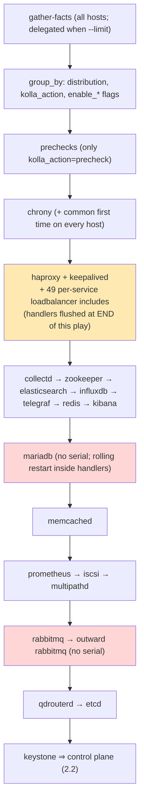
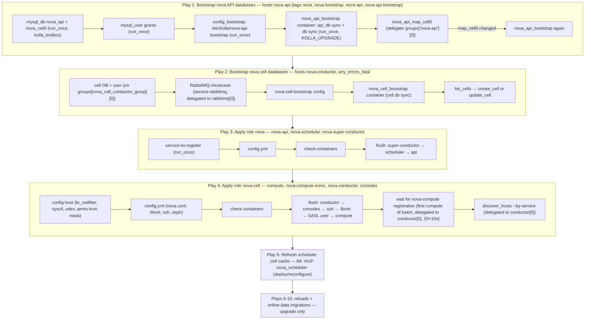
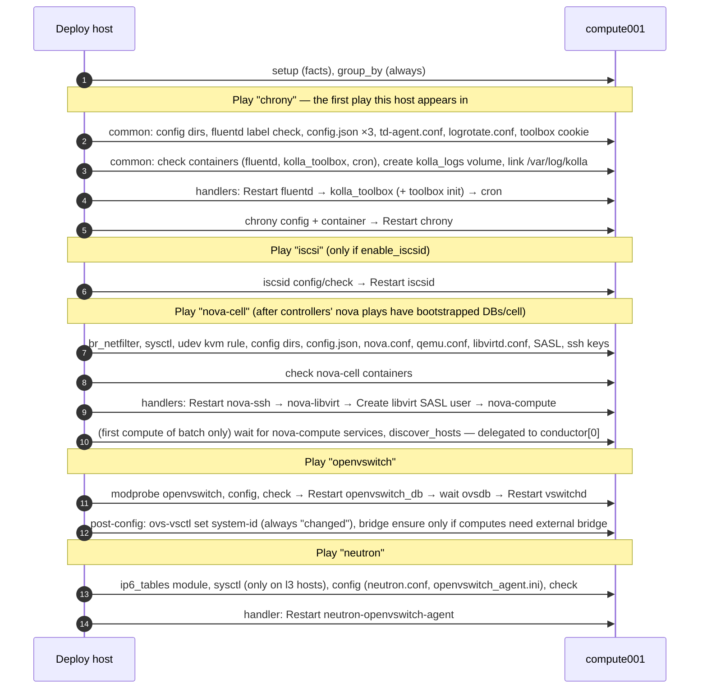
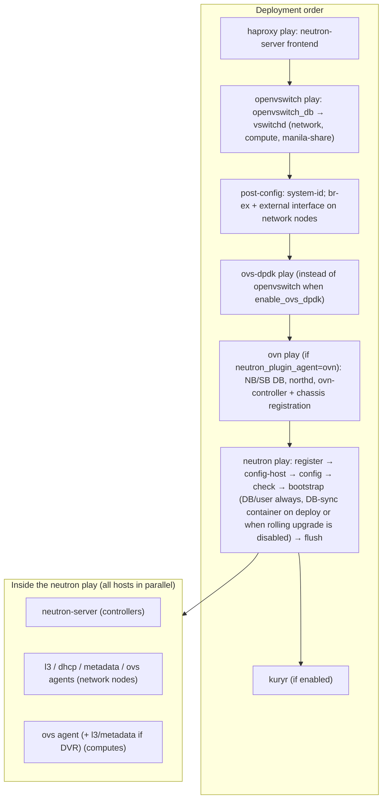

# 04 — Deployment Execution Flow

How Kolla-Ansible Ussuri decides *what runs when*: play order, the steps inside each role, handler flush points,
batching, and how `deploy`, `reconfigure`, `upgrade`, `deploy-containers`, `genconfig`, `pull` and `stop` differ.

> Deployment order (this document) ≠ runtime communication (see [02](02-openstack-component-dependencies.md)).
> Arrows in the diagrams below mean "runs before", unless a diagram explicitly says it shows runtime calls.

---

## 1. How the order is decided

There is **no dependency resolution** in Kolla-Ansible Ussuri. Order comes from five mechanisms only [CODE]:

| Mechanism | Effect | Evidence |
|---|---|---|
| Play order in `site.yml` / `nova.yml` | Services are applied strictly in file order. Ansible's default `linear` strategy runs play N on all its hosts (per batch) before play N+1 | `ansible/site.yml`, generated list in [annex/generated-inventory.md §1](../annex/generated-inventory.md) |
| Role meta dependency on `common` | `common` runs *before* the first role a host meets | `roles/*/meta/main.yml`, `roles/common/tasks/main.yml:1-10` |
| Task order inside a role | Fixed sequence: register → config(-host) → check-containers → bootstrap → flush handlers (§3) | `roles/*/tasks/deploy.yml` |
| Handler flush points | Restarts happen at `meta: flush_handlers` (end of most `deploy.yml`) or at the end of the play. haproxy deliberately defers to the end of its play | e.g. `roles/nova/tasks/deploy.yml:8-9`; haproxy `deploy.yml:8-11` |
| `serial` / `kolla_serial` | Splits a play into batches; each batch completes the whole play, handlers included, before the next starts | `serial: '{{ kolla_serial\|default("0") }}'` on every service play except mariadb, rabbitmq and outward rabbitmq (no `serial` key) and cyborg, which reads `serial: '{{ serial\|default("0") }}'` (`site.yml:1028`), so `kolla_serial` never batches it. The group_by, CentOS-check and prechecks plays have no `serial` key either |

Conditions only *remove* work, never reorder it:

- `when: enable_<svc>` on the role;
- the host-pattern intersection `&enable_<svc>_True`;
- per-task `when:` on `kolla_action`;
- placement filters (`inventory_hostname in groups[...]` / `host_in_groups`).

---

## 2. The five diagrams

### 2.1 Infrastructure services (deployment order)

### 2.2 OpenStack control plane (deployment order)

```mermaid
flowchart LR
  KS["keystone"] --> KF["kafka → storm → karbor"] --> SW["swift"] --> GL["glance"] --> IR["ironic"] --> CI["cinder"] --> PL["placement"] --> NOVA["nova.yml (2.3)"]
  NOVA --> NET["openvswitch / ovs-dpdk → ovn → nova-hyperv → neutron → kuryr (2.5)"]
  NET --> HE["heat"] --> HO["horizon"] --> MISC["murano → solum → magnum → mistral → qinling → sahara → mongodb → panko"]
  MISC --> MA["manila"] --> TEL["gnocchi → ceilometer → monasca → aodh"] --> BA["barbican"] --> MORE["congress → cyborg → tempest → designate → rally → vmtp → trove → watcher → grafana → cloudkitty → freezer → senlin → searchlight → tacker"]
  MORE --> OC["octavia"] --> TAIL["zun → skydive → vitrage → blazar → masakari"]
```

Notable order facts [CODE]:

- **Keystone comes after MariaDB, RabbitMQ and memcached, but before any service that registers with it.**
  `service-ks-register` targets the admin endpoint through the VIP.
- **Placement, Glance and Cinder come before Nova.** Neutron comes *after* Nova (see §2.5).
- **Barbican comes after Nova, Cinder and Glance**, even though they can be configured to use it as a key manager.
  [HYPOTHESIS] On a first deploy with `enable_barbican`, Nova and Cinder start configured with a `[barbican]` section
  before Barbican exists. This is harmless until encrypted volumes are used.
- **Octavia is near the end.** Its amphora resources (image, flavor, network, security group, keypair, certificates)
  are not created by Kolla in Ussuri; they are manual (fact sheet D).

### 2.3 Nova deployment (`ansible/nova.yml`)

Details and Nova runtime dependencies: [05](05-nova-deep-dive.md).

### 2.4 Compute node deployment (what one compute host experiences)

Observed sequence on `compute001` during a full `deploy` in the lab [LAB t0-deploy, trace]:

On a 3-compute lab deployment, a compute host executes about 145 task results, of which about 61 are skips, and
runs 14 handlers. The first controller (control01, which runs the `run_once` and delegated bootstrap tasks) executes
about 444; the other two controllers execute about 332 each [LAB t0-deploy summary,
[annex/lab/results.md](../annex/lab/results.md)].

**Ordering consequence:** on a fresh compute, `nova_compute` is started (and its registration awaited) *before*
`openvswitch` and `neutron_openvswitch_agent` exist on that host. Instances cannot be scheduled there successfully
until the later plays finish. On a running cloud this matters when you add computes with `--limit` (see
[07](07-day2-operational-impact.md) §G).

### 2.5 Networking components

The neutron play deploys the server and *all* agents in a single play and a single handler flush. Agents are not
deployed after the server has been verified. The RPC layer tolerates the agents starting first.

---

## 3. Inside a role: the standard `deploy` sequence

Typical `deploy.yml` (Nova shown; Neutron adds `config-host`, and by default skips its DB-sync container on reconfigure):

| Step | Typical task file | Scope | Runs on `reconfigure`? |
|---|---|---|---|
| 1. Keystone registration | `register.yml` → `service-ks-register` | `run_once` (per batch) via `kolla_toolbox` on the first host of the play | **yes** |
| 2. Host configuration | `config-host.yml` (sysctl, modules, udev) | per host | yes |
| 3. Config generation | `config.yml` (dirs, `config.json`, INI merges, policy, certs) | per host × per service × per file | yes |
| 4. Container check | `check-containers.yml` (`compare_container` + `kolla_set_configs --check`) | per host × per container | yes |
| 5. Bootstrap | `bootstrap.yml` (DB, user, grants) + `bootstrap_service.yml` (one-shot container: DB sync) | `run_once` / first host of the group | **yes** for most roles (Neutron: DB/user/grants yes. The `bootstrap_neutron` DB-sync container only when `neutron_enable_rolling_upgrade` is false, default `yes`, `roles/neutron/tasks/bootstrap_service.yml:21-22`) |
| 6. Flush handlers | `meta: flush_handlers` | notified hosts, in handler definition order | yes |
| 7. Post steps | e.g. openvswitch `post-config.yml`, nova-cell discovery | varies | yes |

Order caveats:

- **Some roles bootstrap *before* containers start, some after.** Nova bootstraps in separate plays before the
  service plays (`nova.yml:24-96`). Neutron runs its bootstrap *after* check-containers but *before* the flush
  (`roles/neutron/tasks/deploy.yml:11-21`). Keystone, Glance and Cinder vary (fact sheets B, C).
- **haproxy does not flush in `deploy.yml`.** The NOTE in `roles/haproxy/tasks/deploy.yml:8-11` explains that site.yml
  handles all haproxy changes in that play, so the restart happens once, after all per-service frontends are
  rendered.

---

## 4. Action matrix: what each `kolla_action` does

| Action (CLI) | Config written | Containers compared | Handlers (restarts) | Bootstrap / DB sync | Keystone registration | Images pulled | Notes |
|---|---|---|---|---|---|---|---|
| `deploy` | yes | yes | yes | yes | yes | only if absent | Full flow |
| `reconfigure` | yes | yes | yes | yes (most roles) | yes | only if absent | Identical to deploy in most roles (01 §4.2). `kolla_serial` passed |
| `upgrade` | yes | yes | yes | upgrade-specific (`bootstrap_upgrade`, rolling or legacy upgrade, online migrations) | yes (some roles) | only if absent → run `pull` first | Nova reload plays and online migrations are active only here |
| `deploy-containers` | **no** | yes (incl. config drift vs files already on disk) | yes | no | no | only if absent | `tasks/deploy-containers.yml` = `check-containers.yml`. haproxy includes skipped (`site.yml:392`) |
| `genconfig` (`config`) | yes | no | **all skipped** (`when: kolla_action != "config"`) | no | no | no | Fluentd label check still pulls the fluentd image if missing (`roles/common/tasks/config.yml:26-37`) |
| `pull` | no | no | no | no | no | **yes**, every enabled container mapped to the host, plus `common` | `service-images-pull` |
| `stop` | no | no | no | no | no | no | `stop_container` for every enabled container on the host, honouring `skip_stop_containers` |
| `precheck` | no | no | no | no | no | no | `prechecks` role + each role's `precheck.yml` (port checks, group validation) |
| `check` | no | no | no | no | no | no | `check.yml` (mostly empty; sanity checks disabled by default) |

The combination **`genconfig` → (review the diff) → `deploy-containers --limit <batch>`** is the only built-in way to
separate "write the config" from "apply it", and to apply in controlled batches. It works because
`compare_container` detects config drift through `kolla_set_configs --check` [CODE `kolla_docker.py:543-578`, LAB
s14 → s15]. See [07](07-day2-operational-impact.md) §H.

---

## 5. Batching (`serial`) and its interaction with order

```mermaid
gantt
  dateFormat X
  axisFormat %s
  title Play execution with kolla_serial=2 (illustrative, 4 computes)
  section nova-cell play
  batch 1 (compute001-002) config→check→flush→discover :a1, 0, 30s
  batch 2 (compute003-004) config→check→flush→discover :a2, after a1, 30s
  section openvswitch play
  batch 1 :b1, after a2, 15s
  batch 2 :b2, after b1, 15s
```

- **A batch runs the complete play before the next batch starts.** That includes handler restarts and the compute
  discovery. Batches therefore bound the number of simultaneous restarts *per play*, but **each play is still
  traversed batch by batch for the whole fleet before the next play starts**. The neutron agents on compute001 are
  restarted only after *all* computes have finished the nova-cell and openvswitch plays.
- **`run_once` tasks run once per batch** (03 §2.5). Examples: DB sync, Keystone registration, compute discovery
  (`wait_discover_computes.yml` runs for `all_computes_in_batch[0]`).
- **mariadb and rabbitmq always run all hosts in one batch** (no `serial` key). Their handlers implement the rolling
  restart themselves (fact sheet B). cyborg is not batched by `kolla_serial` either: its play reads `serial` instead.
- **`kolla_serial` must be set through the environment.** It reaches only `reconfigure` and `upgrade` through the
  wrapper (`ANSIBLE_SERIAL`). For `deploy`, pass `-e kolla_serial=N` yourself (for `deploy` it is not overridden).

---

## 6. Initial deployment vs reconfiguration: what actually differs

| Aspect | Initial `deploy` (empty hosts) | `reconfigure` on a running cloud |
|---|---|---|
| Containers | All `create+start` [LAB t0: 37 container types, 136 `create+start` instances. Exception: mariadb on the bootstrap host control01 runs through `bootstrap_mariadb`, then is started, recreated and restarted by its handlers] | Restart (config) or recreate (image or params) **only if** drift is detected; otherwise none [LAB t1: 0 restarts] |
| One-shot containers | DB bootstrap for every service, MariaDB and RabbitMQ bootstrap, fernet key generation, cell creation | DB sync containers **still run** for keystone, glance, cinder, placement, nova (×4), heat, plus barbican, octavia and others [LAB t1: 8 DB-sync bootstraps (keystone, glance, cinder, placement, neutron, heat, nova API, nova cell) + map_cell0 + 2× list_cells; s18 (`reconfigure`): the same minus neutron]. MariaDB/RabbitMQ bootstrap are not re-run |
| Handler order effects | Every handler fires | Only notified handlers fire, but loop-notify widens them to all containers of the role on that host (03 §2.4) |
| Neutron DB sync (`bootstrap_neutron`) | runs | skipped by default (`neutron_enable_rolling_upgrade: yes`). The DB/user/grant tasks still run |
| Nova cell | `create_cell` | `update_cell` only if the transport URL or DB URL changed (`roles/nova-cell/tasks/create_cells.yml:31-55`) |
| Fernet keys | generated | **re-distributed** from the first running keystone_fernet node to the others (fact sheet B §3.6, task flow in §3.3) |
| MariaDB | Galera bootstrap on the first host | cluster lookup; rolling restart waves if config changed |
| Duration drivers | image pulls, first container starts | per-task SSH overhead across all hosts, `compare_container` exec per container (see [06](06-compute-scaling-and-performance.md)) |

---

## 7. Dependencies introduced by handlers

Handlers create ordering that is not visible in task files:

1. **Within a role, restart order = handler definition order, not notification order.**
   - nova-cell restarts `nova_ssh` → `nova_libvirt` (→ SASL user) → `nova_compute` (`roles/nova-cell/handlers/main.yml`).
   - openvswitch restarts `openvswitch_db` → waits → `openvswitch_vswitchd`.
   - [LAB t0 trace above.]
2. **Handlers of a play run on all notified hosts in parallel.** With `serial: 0`, every compute restarts
   `nova_compute` (and, through loop-notify, `nova_libvirt`) in the same step.
3. **Handler chains:**
   - Restart nova-libvirt → Create libvirt SASL user.
   - Restart openvswitch-db → Waiting for openvswitch_db.
   - Restart kolla-toolbox → Initializing toolbox.
   - Restart haproxy → Waiting for haproxy.
   - Restart keepalived → Waiting for virtual IP.
4. **Handlers can cross roles.** `haproxy-config` (called from every service's `loadbalancer.yml`) notifies the
   haproxy role's `Restart haproxy container`. This is why the haproxy play includes the haproxy role even for
   `-t <svc>`.
5. **The MariaDB restart is itself a sequence of handler-driven waves** (`index % 4`), with port and WSREP waits
   between waves (fact sheet B §1.5).
