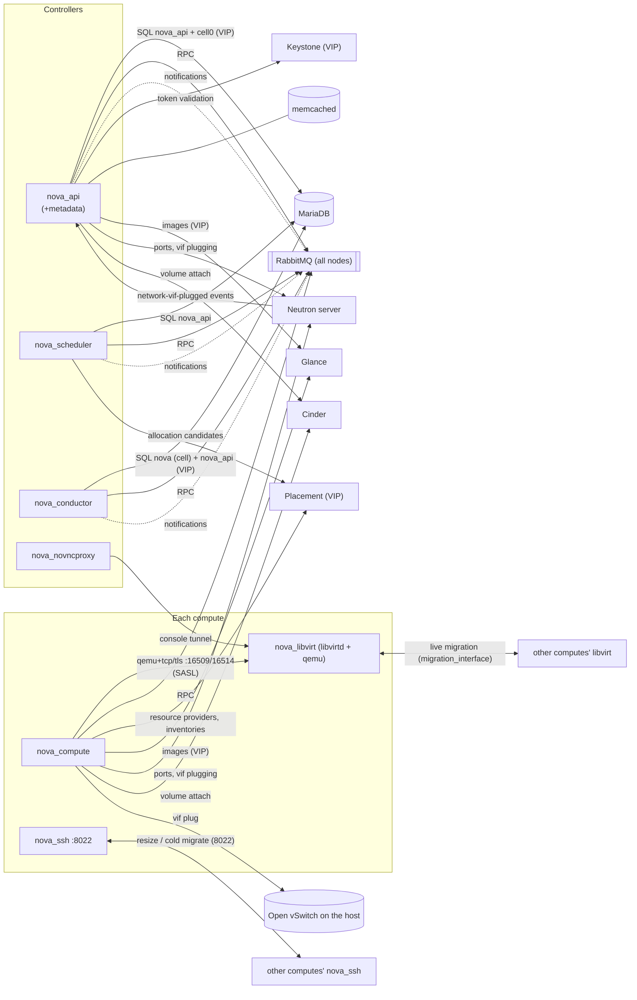

# 05 — Nova Deep Dive (Kolla-Ansible Ussuri)

Nova is split into two roles and ten plays. It is the component with the most hosts (every compute), the most
coupling (Glance, Neutron, Placement, Cinder, Keystone, RabbitMQ, MariaDB) and the highest VM-impact risk.

---

## 1. Components, roles, containers and placement

| Component | Container | Role | Inventory group (default) | Placement variable | Notable container flags | Evidence |
|---|---|---|---|---|---|---|
| nova-api (+ metadata API) | `nova_api` | `nova` | `nova-api` → `nova` → `control` | `group: nova-api` | **privileged**, `/lib/modules` | `roles/nova/defaults/main.yml:2-43` |
| nova-scheduler | `nova_scheduler` | `nova` | `nova-scheduler` | `group` | – | `:44-50` |
| nova-super-conductor | `nova_super_conductor` | `nova` | `nova-super-conductor` | `enabled: enable_cells` (default `no`) | – | `:51-57` |
| nova-conductor (cell) | `nova_conductor` | `nova-cell` | `nova-conductor` | `group: nova_cell_conductor_group` | – | `roles/nova-cell/defaults/main.yml:40-46` |
| nova-novncproxy | `nova_novncproxy` | `nova-cell` | `nova-novncproxy` | `enabled: nova_console == 'novnc'` | – | `:19-25` |
| nova-spicehtml5proxy | `nova_spicehtml5proxy` | `nova-cell` | `nova-spicehtml5proxy` | `nova_console == 'spice'` | – | `:26-32` |
| nova-serialproxy | `nova_serialproxy` | `nova-cell` | `nova-serialproxy` | `enable_nova_serialconsole_proxy` | – | `:33-39` |
| nova-compute | `nova_compute` | `nova-cell` | `compute` | `group: nova_cell_compute_group` | **privileged**, **`ipc_mode: host`**, `/dev`, `/run:shared`, `/lib/modules`, `iscsi_info` (if iscsid), `nova_compute` volume `/var/lib/nova`, `libvirtd` volume | `:47-56` |
| nova-libvirt | `nova_libvirt` | `nova-cell` | `compute` | `enabled: nova_compute_virt_type in ['kvm','qemu']` | **privileged**, **`pid_mode: host`**, `/dev`, `/run:shared`, **`/sys/fs/cgroup` (rw)**, `libvirtd:/var/lib/libvirt`, `nova_libvirt_qemu:/etc/libvirt/qemu`, instance datadir | `:3-11`, volumes `:210-223` |
| nova-ssh | `nova_ssh` | `nova-cell` | `compute` | `enable_nova_ssh` (default yes) | sshd on `migration_interface_address:8022` | `:12-18`; `templates/sshd_config.j2:1-2` |
| nova-compute-ironic | `nova_compute_ironic` | `nova-cell` | `nova-compute-ironic` | `enable_ironic` and cell match | – | `:57-63` |

Cells: `nova_cell_name` is empty by default (a single cell named `''`, the pre-Train layout). For multi-cell, every
`nova_cell_*_group` variable points at a per-cell group (`roles/nova-cell/defaults/main.yml:81-123`). `enable_cells`
then deploys `nova_super_conductor` at the API level.

---

## 2. Dependency classification

### 2.1 Installation (deploy-time) dependencies

What must work **while Kolla runs** the nova plays:

| Dependency | Used by | Evidence | Failure mode |
|---|---|---|---|
| MariaDB (through the VIP) + `kolla_toolbox` on the first `nova-api` and first `nova-conductor` host | `mysql_db` / `mysql_user` | `roles/nova/tasks/bootstrap.yml:2-45`; `roles/nova-cell/tasks/bootstrap.yml:2-33` | play aborts; cell play has `any_errors_fatal: true` (`nova.yml:75`) |
| RabbitMQ (first host of `nova_cell_rpc_group_name`) | vhost/user creation via `service-rabbitmq`, delegated | `roles/nova-cell/tasks/rabbitmq.yml:2-29` | cell bootstrap fails, all hosts fail |
| Keystone admin endpoint | `service-ks-register` (services `nova`, `nova_legacy`, user `nova`) | `roles/nova/tasks/register.yml`; `defaults/main.yml:155-176` | retries 5 × 10 s, then fail |
| Docker registry (only if the image is absent) | bootstrap and service containers | `kolla_docker.start_container` pulls if absent | fail |
| **Running `nova_conductor` on `groups[nova_cell_conductor_group][0]`** | `discover_hosts` uses `docker exec nova_conductor` | `roles/nova-cell/tasks/discover_computes.yml:14-21` | discovery fails (`any_errors_fatal`) |
| **Running `kolla_toolbox` on that conductor** + Keystone + nova-api | `openstack compute service list` to wait for compute registration | `roles/nova-cell/tasks/wait_discover_computes.yml:8-42` | 20 retries × 10 s, then fail only the hosts that did not register |
| Facts of all RabbitMQ, memcached and haproxy hosts | transport URLs, memcache lists, haproxy backends | `group_vars/all.yml:206,216` | templating error. This is why `gather-facts.yml` gathers facts for all hosts even with `--limit` |

### 2.2 Runtime dependencies (what Nova needs to *operate*)

| Nova component | Requires at runtime | Evidence (template) |
|---|---|---|
| nova-api | MariaDB (`nova_api` and `nova_cell0`), RabbitMQ, Keystone (authtoken + memcached), Placement, Glance, Neutron, Cinder | `roles/nova/templates/nova.conf.j2:30,60-61,67,80,97-105,110-136,169` |
| nova-scheduler | MariaDB (`nova_api`), RabbitMQ, Placement. Filters: `AvailabilityZone`, `Compute`, `ComputeCapabilities`, `ImageProperties` (+ server-group filters) | `nova.conf.j2:32-39`. `discover_hosts_in_cells_interval = -1` (`:166`): **the scheduler never discovers hosts by itself** |
| nova-conductor (cell) | MariaDB (cell DB, and the API DB because `nova_cell_conductor_has_api_database: yes`), RabbitMQ | `roles/nova-cell/templates/nova.conf.j2:142-157` |
| nova-compute | RabbitMQ (**no DB access**: the `[database]` section is excluded for `nova-compute*`), Keystone, Placement, Glance, Neutron, Cinder, local libvirt, local OVS | `nova-cell/templates/nova.conf.j2:42,105-139,142,203-213`; libvirt `connection_uri` in `nova.conf.d/libvirt.conf.j2:1-7` |
| nova-libvirt | `/dev/kvm` (udev rule `99-kolla-kvm.rules`), the `br_netfilter` module, Ceph (if `nova_backend: rbd`: `ceph.conf`, secret XML/base64 in `nova-libvirt/secrets`) | `nova-cell/tasks/config-host.yml`, `external_ceph.yml` |
| nova-novncproxy | Reaches libvirt VNC on each compute (`server_listen`/`server_proxyclient_address = api_interface_address`) | `nova-cell/templates/nova.conf.j2:48-63` |

### 2.3 Configuration dependencies (inputs that change Nova's files)

These change `nova.conf` on **every compute**. The result is a restart of `nova_compute` (and, through loop-notify,
`nova_libvirt` and `nova_ssh`) on every compute during the next run that executes the nova-cell play:

| Input | Template line | Why it is "global" |
|---|---|---|
| RabbitMQ group membership, user, password, port | `transport_url` (`nova-cell/templates/nova.conf.j2:42,184`) | `rpc_transport_url` lists all rabbitmq hosts (`group_vars/all.yml:206`) |
| `enable_ceilometer`, `enable_searchlight`, `enable_designate`, `enable_neutron_infoblox_ipam_agent` | `[notifications]` / notification driver (`:34-40,215-225`) | global flags |
| `enable_watcher`, `enable_cinder`, `enable_osprofiler`, `enable_barbican` | `:37,111,226,234` | global flags [LAB s07: enabling Barbican restarted all nova containers] |
| Glance, Neutron, Placement, Keystone endpoints and service passwords (`placement_keystone_password`, `neutron_keystone_password`, `cinder_keystone_password`, `nova_keystone_password`, `metadata_secret`) | `[glance]`, `[neutron]`, `[placement]`, `[cinder]` | `passwords.yml` and VIP/FQDN settings |
| `nova_console`, `enable_nova_serialconsole_proxy`, `kolla_external_fqdn`, `public_protocol` | `[vnc]`/`[spice]`/`[serial_console]` (`:48-88`) | console URLs embed the external FQDN |
| `libvirt_tls`, `libvirt_enable_sasl`, `migration_interface`, `nova_backend`, Ceph settings | `nova.conf.d/libvirt.conf.j2`, `libvirtd.conf.j2`, `qemu.conf.j2` | change the libvirt **and** compute containers |
| Operator overrides | `/etc/kolla/config/global.conf`, `nova.conf`, `nova/nova-compute.conf`, `nova/<host>/nova.conf` | merge order in `nova-cell/tasks/config.yml:63-75` |

Inputs that do **not** reach compute hosts: the memcached membership (no memcache settings in the nova-cell
template) and MariaDB settings (no `[database]` on computes).

### 2.4 Operational dependencies (what restarts what)

| Trigger | Restarted on computes | Restarted on controllers | Evidence |
|---|---|---|---|
| Any change of `nova-compute`'s `nova.conf` / `config.json` / image | `nova_compute` **+ `nova_libvirt` + `nova_ssh`** (loop-notify), then "Create libvirt SASL user" | – | [LAB s03] |
| Change of `/etc/kolla/config/nova.conf` or a global flag | all three on every compute | nova_api, nova_scheduler, nova_conductor, nova_novncproxy (+ super conductor if `enable_cells`) | [LAB s02, s07] |
| Scheduler-only override | – | `nova_scheduler` **+ `nova_api`** (loop-notify) | [LAB s04] |
| New image for nova-compute (after `pull`) | `nova_compute` recreated, `nova_libvirt` + `nova_ssh` restarted | – | [LAB s09c] |
| Any `deploy`/`reconfigure` with `nova` or `nova-api` tag, even with no change | – | `nova_scheduler` receives `SIGHUP` (cell-cache refresh) | `roles/nova/tasks/refresh_scheduler_cell_cache.yml:10` [LAB s01] |
| Libvirt TLS certificate change | `nova_libvirt` + `nova_compute` (+ `nova_ssh` by loop-notify) | – | `nova-cell/tasks/config-libvirt-tls.yml` |
| Ceph keyring / `ceph.conf` / secret change | `nova_compute`, `nova_libvirt` | – | `nova-cell/tasks/external_ceph.yml` |

---

## 3. What must be available before Nova can operate

Ordered by necessity [CODE + upstream Nova behaviour, marked HYPOTHESIS where upstream]:

1. **MariaDB (through HAProxy and the VIP)** with the `nova_api`, `nova_cell0` and `nova` (cell) schemas migrated.
   Without it, API, scheduler and conductor fail. Computes keep running VMs, but their state reporting through the
   conductor fails.
2. **RabbitMQ** with the cell vhost and user. All RPC between API, scheduler, conductor and compute uses it. Computes
   also use it to report liveness: the service heartbeat goes through the conductor.
3. **Keystone + memcached.** Every API request; nova-compute also needs Keystone to talk to Neutron, Placement,
   Glance and Cinder.
4. **Placement.** The scheduler's allocation candidates and nova-compute's resource-provider updates. Without it
   there is no scheduling, and computes log errors [HYPOTHESIS].
5. **Cell mapping and host mapping.** `map_cell0`, `create_cell` and **`discover_hosts`**. A compute that was not
   discovered gets no instances: it is not in a host mapping, and the scheduler does not discover hosts by itself
   (`discover_hosts_in_cells_interval = -1`).
6. **Neutron server + an L2 agent on the compute** (neutron-openvswitch-agent + OVS, or ovn-controller). Instance
   boot waits for the `network-vif-plugged` event [HYPOTHESIS: upstream default `vif_plugging_is_fatal=True`].
7. **Glance** for image-backed boots. **Cinder** for volume-backed boots.
8. **libvirt (+ KVM, `br_netfilter`, udev rule)** on the compute. nova-compute fails to start its driver without
   libvirt.

---

## 4. The nova plays step by step (`ansible/nova.yml`)

| # | Play (lines) | Hosts | Runs on | Key tasks (evidence) |
|---|---|---|---|---|
| 1 | Bootstrap nova API databases (`29-61`) | `nova-api` | deploy, reconfigure; upgrade → `bootstrap_upgrade` | `mysql_db` nova_api/cell0 (`run_once`); grants; `nova-api-bootstrap` config (`run_once`); `nova_api_bootstrap` one-shot container (`roles/nova/tasks/bootstrap_service.yml:4-23`); `map_cell0` delegated to `groups['nova-api'][0]` (`map_cell0.yml:2-26`) |
| 2 | Bootstrap nova cell databases (`63-96`) | `nova-conductor` | deploy, reconfigure; upgrade | cell DB/user on the first conductor; RabbitMQ vhost/user; `nova_cell_bootstrap` one-shot (cell DB sync); `list_cells` → `create_cell` or `update_cell` (only if the MQ or DB URL changed) |
| 3 | Apply role nova (`99-114`) | `nova-api`, `nova-scheduler`, `nova-super-conductor` | every action | standard role: register, config, check-containers, flush |
| 4 | Apply role nova-cell (`117-135`) | `compute`, `nova-compute-ironic`, `nova-conductor`, consoles | every action | config-host, config, check, flush, **wait for compute registration + discover_hosts** |
| 5 | Refresh scheduler cell cache (`140-156`) | `nova-scheduler` | deploy, reconfigure | `kill -HUP $(docker inspect … nova_scheduler)` |
| 6 | Reload super conductor (`164-181`) | `nova-super-conductor` | upgrade | `recreate_or_restart` to drop the RPC pin |
| 7 | Reload cell services (`183-205`) | computes, conductors, consoles | upgrade | same |
| 8 | Reload API services (`207-225`) | api, scheduler | upgrade | same |
| 9 | API online data migrations (`230-247`) | `nova-api[0]` | upgrade | `nova_api_online_data_migrations` one-shot |
| 10 | Cell online data migrations (`253-272`) | `nova-conductor` (first) | upgrade | `any_errors_fatal` |

**Discovery mechanics** (`roles/nova-cell/tasks/deploy.yml:24-42`, `wait_discover_computes.yml`,
`discover_computes.yml`):

- It runs once per **batch** on the first compute of the batch (`all_computes_in_batch[0]`), delegated to the first
  conductor of the cell.
- It waits until `openstack compute service list --service nova-compute` contains every compute of the batch, keyed
  by `ansible_facts.nodename`. It tries 20 times at 10 s intervals (up to about 200 s).
- Then it runs `nova-manage cell_v2 discover_hosts --by-service --cell_uuid …` once.
- A compute that did not register **fails only that host**, unless `nova_compute_registration_fatal: true`.

---

## 5. nova-libvirt: why its restart is special

Facts [CODE]:

- **`pid_mode: host`, privileged, `/sys/fs/cgroup` mounted read-write** (`roles/nova-cell/defaults/main.yml:3-11,210-223`).
  QEMU processes are started by libvirtd *inside* this container.
- **Persistent state lives on named volumes.** The `libvirtd` volume holds `/var/lib/libvirt` and the
  `nova_libvirt_qemu` volume holds domain XML in `/etc/libvirt/qemu`. Instance disks sit in
  `nova_instance_datadir_volume` (`/var/lib/nova`). All of them survive a container recreate.
- **The restart handler retries 5 times.** "Restart nova-libvirt container" uses `retries: 5 / until: success`. The
  in-code note says: *"retry 5 to remove nova_libvirt container because when guests running, nova_libvirt will raise
  error even though it is removed"* (`roles/nova-cell/handlers/main.yml:87-109`). The authors therefore expect running
  guests during libvirt restarts.
- **After every libvirt restart, `Create libvirt SASL user` runs** (`saslpasswd2` inside the container,
  `handlers/main.yml:111-122`), because the SASL DB may not persist.
- **Effective stop timeout is 10 s** (01 §6). libvirtd gets SIGKILL after 10 s.
- **Libvirt is restarted before nova-compute.** In the handler order `nova-libvirt` comes before `nova-compute`, so
  during the window nova-compute is still running against a libvirtd that is going away.
- **Kolla ships, but does not install, a guest shutdown helper.** `tools/kolla-libvirt-guests.service` (with
  `virt-guest-shutdown.target`) is for host shutdown; no playbook references it.

What happens to running VMs is **not provable by static analysis** [NEEDS-LAB]:

- [HYPOTHESIS] With libvirt's systemd/cgroupfs integration, each QEMU process is moved into its own `machine.slice`
  scope on the *host* cgroup tree, which is possible because `/sys/fs/cgroup` is mounted rw. QEMU then survives the
  stop of the libvirtd container, and libvirtd re-attaches to running domains on start from the `/var/run/libvirt`
  and `/etc/libvirt/qemu` state. This matches the widespread operator experience that restarting `nova_libvirt`
  normally does not kill instances.
- [HYPOTHESIS] Known risk windows:
  - live migrations in flight fail;
  - attach/detach and snapshot operations in progress fail;
  - `virsh` and nova-compute calls fail until libvirtd is back;
  - on cgroup v2 hosts, or Docker versions that clean up the container cgroup on stop, QEMU processes could be killed;
  - the 10 s SIGKILL could interrupt libvirtd while it writes domain state.
- **Required experiment:** on a staging compute with running VMs, run `docker restart nova_libvirt` and then
  `kolla-ansible -t nova reconfigure --limit <host>` with a nova-compute-only override. Record the QEMU PIDs
  (`pgrep -f qemu-kvm`), the cgroup of each QEMU PID (`/proc/<pid>/cgroup`), guest ping continuity, and the
  `virsh list` state before and after. Run it on the exact kernel, cgroup version and Docker version of production.

nova-compute restart [HYPOTHESIS, upstream Nova]:

- Running VMs are not affected.
- The service is marked down only if the restart exceeds `service_down_time` (60 s default).
- In-flight operations owned by that compute (boot, resize, migration) can fail or be left in transitional
  task_state.
- On start, `init_host` reconciles instance state and power state.

---

## 6. Live migration, resize and consoles

| Function | Mechanism in Ussuri Kolla | Dependency |
|---|---|---|
| Live migration | libvirt `qemu+tcp://<migration_interface_address>/system` (or `qemu+tls://<migration_hostname>` with `libvirt_tls`), SASL auth by default (`libvirt_enable_sasl: true`) | `nova_libvirt` on **both** source and destination computes, the `migration_interface` network, matching SASL credentials, and with TLS, hostnames resolvable on every compute (`/etc/hosts` from `bootstrap-servers`, fact sheet E §5) |
| Cold migration / resize | `nova_ssh` sshd on port 8022, with keys from `passwords.yml` (`nova_ssh_key`) | `nova_ssh` on both hosts and a shared instance datadir layout |
| VNC console | `nova_novncproxy` (controllers) → compute `server_proxyclient_address` | `api_interface` reachable from the proxy hosts. Public URL is built from `kolla_external_fqdn` |
| Scheduling | `nova_scheduler` + Placement + host mappings | discovery must have run for new computes |

Impact of a Kolla run on these:

- A run that restarts `nova_libvirt` (any nova-compute change, by loop-notify) **interrupts every live migration in
  progress** on the affected computes. With `serial: 0`, that is every compute at once.
- A `nova_ssh` restart interrupts resizes or cold migrations that are copying disks.
- Every `deploy`/`reconfigure` with a nova tag SIGHUPs the schedulers and runs `discover_hosts`. Neither affects
  existing instances.

---

## 7. Upgrade path specifics

| Item | Behaviour | Evidence |
|---|---|---|
| `nova-status upgrade check` | Runs on `nova-api[0]`. The play fails if rc ∉ {0,1} | `roles/nova/tasks/upgrade.yml:2-16` |
| `nova_safety_upgrade: yes` | Stops all API-level nova services first. Handlers skip restarts during upgrade; the reload plays start them again | `upgrade.yml:18-28`; handlers `when: kolla_action != "upgrade" or not nova_safety_upgrade` |
| Rolling upgrade | `config` → `check-containers` → `flush_handlers`. Restarts happen per batch only if `ANSIBLE_SERIAL` is set. The TODO in `rolling_upgrade.yml:7-10` admits they are not serialised | `roles/nova/tasks/rolling_upgrade.yml` |
| RPC version pin removal | After upgrade, the reload plays restart conductors → computes → API (`recreate_or_restart`), after waiting `nova_compute_startup_delay` (30 s) for computes to report versions | `nova.yml:158-225`; `nova-cell/handlers/main.yml:187-196` |
| Online data migrations | After all cells are upgraded | `nova.yml:227-272` |
| Image pull | Not part of `upgrade`. `start_container` pulls only if the image is absent. **Run `kolla-ansible pull` first.** Otherwise each host downloads lazily during the handler phase, which lengthens every restart window | `kolla_docker.py:805-808` |
