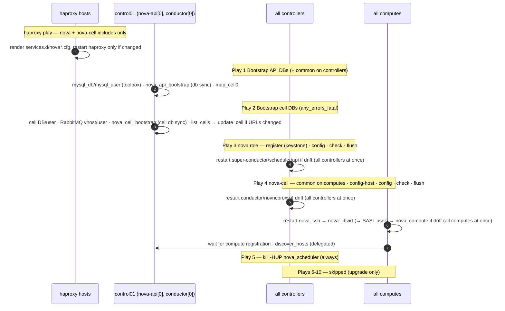
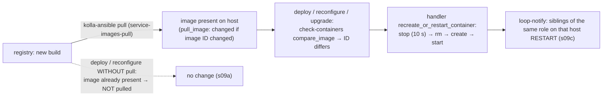

# 07 — Day-2 Operational Impact

What really happens when Kolla-Ansible Ussuri commands run against a live platform. Each scenario was executed in the
lab with the **unmodified `site.yml`** (Ansible 2.9.27, simulated hosts, `kolla_docker` stub mirroring the real
decision logic). Every scenario starts from the same deployed state: 3 controllers, 2 network nodes, 3 computes, 1
storage node and 1 monitoring node, with Keystone, Glance, Placement, Nova, Neutron/OVS, Cinder/LVM, Heat and Horizon.
Raw per-run numbers are in [annex/lab/results.md](../annex/lab/results.md).

Throughout this document:

- **The code guarantees** = what Kolla will do (tasks, restarts) given the inputs.
- **Depends on the environment** = what that does to VMs and APIs; marked [HYPOTHESIS] or [NEEDS-LAB].

Three mechanisms explain almost every surprise below, so they are restated here:

1. **Config drift ⇒ full container stop/start.** It is never a reload. The stop timeout is effectively **10 s**
   (01 §6).
2. **Loop-notify.** One changed container in a role's loop restarts *every* container of that role on that host
   (03 §2.4).
3. **Global inputs.** `enable_*` flags, group membership and passwords are rendered into per-host files on every host
   (02 §5).

---

## A. Reconfigure Nova

### A.1 Execution sequence (`kolla-ansible -t nova reconfigure`)



### A.2 What changes, per type of change [LAB]

| Change | Files rewritten | Restarted on controllers | Restarted on **every compute** | Run |
|---|---|---|---|---|
| none | – | – | – | s01 |
| `/etc/kolla/config/nova.conf` (global override) | `nova.conf` of every nova service | nova_api, nova_scheduler, nova_conductor, nova_novncproxy | **nova_compute, nova_libvirt, nova_ssh** | s02 |
| `/etc/kolla/config/nova/nova-compute.conf` | `nova-compute/nova.conf` only | – | **nova_compute, nova_libvirt, nova_ssh** (libvirt and ssh by loop-notify) | s03 |
| `/etc/kolla/config/nova/nova-scheduler.conf` | `nova-scheduler/nova.conf` only | nova_scheduler **+ nova_api** (loop-notify) | – | s04 |
| `enable_barbican: yes` (Barbican not even deployed) | `nova.conf` everywhere (adds `[barbican]`); `td-agent.conf`, `logrotate.conf` | all nova + fluentd, cron, kolla_toolbox | all nova incl. libvirt + fluentd, cron, kolla_toolbox | s07 |
| same as s02 with `kolla_serial=1` | same | one controller at a time | **one compute at a time**; API DB sync and map_cell0 repeated per batch (3×) | s16 |

### A.3 Are all compute nodes affected? Does nova-compute restart on every compute?

- **Tasks:** yes. The nova-cell play targets the whole `compute` group (`nova.yml:117-135`). Every compute produces
  56–65 task results even when nothing changes (33–42 of them executed, about 46–53 remote module invocations)
  [LAB s01, profile in [06](06-compute-scaling-and-performance.md)].
- **Restarts:** only where drift is detected. But most Nova-related changes are global (02 §5, 05 §2.3), so in
  practice either *no* compute restarts or *all* computes restart. They restart in the same handler step unless
  `ANSIBLE_SERIAL`/`kolla_serial` is set or `--limit` is used.
- **libvirt goes with it.** Whenever nova-compute restarts because of config or image drift, **nova-libvirt and
  nova-ssh restart too** (loop-notify, s03/s09c). Kolla's own handler ordering restarts libvirt *before*
  nova-compute.

### A.4 Running VMs, live migration, scheduling

| Effect | Guaranteed by code | Depends on environment |
|---|---|---|
| nova-compute stop/start (10 s SIGKILL) | yes, when drift | [HYPOTHESIS] VMs unaffected; in-flight operations on that host fail or are left mid-task; the service is reported down only if the restart exceeds `service_down_time` |
| libvirtd stop/start | yes, whenever nova-compute drifts | [NEEDS-LAB] VMs normally survive (QEMU moved to `machine.slice`, cgroup mounted rw, `pid_mode: host`). Live migrations in progress **fail**. Libvirt API calls fail for seconds. Run the experiment in 05 §5 before trusting this |
| nova-ssh stop/start | yes, with the above | resize / cold migration disk copies over port 8022 are interrupted |
| Scheduling | API and scheduler restarts are parallel on all controllers (serial 0) | API calls fail during the restart window. The scheduler gets SIGHUP on every run (cell-cache refresh), which is harmless |
| Host mapping | `discover_hosts` runs every time | harmless; maps any newly registered compute |

### A.5 Operational risks and verification

- **Risks:** R1, R2, R3, R24 in [08](08-operational-risk-matrix.md).
- **Before:**
  - `kolla-ansible -t nova genconfig` (restarts nothing), then diff `/etc/kolla/nova-*/nova.conf` on one controller
    and one compute.
  - `docker exec nova_compute kolla_set_configs --check` on a few computes: exit 1 means the container *will*
    restart, and so will `nova_libvirt` and `nova_ssh`.
  - No active live migrations: `openstack server list --all-projects --status MIGRATING`.
- **Apply in batches:** `deploy-containers --limit` (§H) or `ANSIBLE_SERIAL`.
- **After:**
  - `openstack compute service list` (all up);
  - `docker ps --filter name=nova_ -a` (all `Up`, recent `Created`/`Started`);
  - `virsh list --all` inside `nova_libvirt` on a sample of computes (domains running), with guest pings;
  - `nova-manage cell_v2 list_hosts` count equals the number of computes.

---

## B. Reconfigure Neutron

### B.1 Execution and targets

`kolla-ansible -t neutron reconfigure` runs:

1. the haproxy play (neutron-server frontend);
2. the neutron play on `neutron-server`, every agent group, **every compute** and `manila-share` (`site.yml:761-780`).

Per host the steps are: `common` (first play for the host under this tag), register (run_once), config-host
(`ip6_tables` module; sysctl on L3 hosts), config, check-containers, bootstrap, flush. The bootstrap step always runs
the Neutron DB and user/grant tasks (`mysql_db`/`mysql_user` via kolla_toolbox, run_once, delegated to
neutron-server[0], skipped only with `use_preconfigured_databases`, `roles/neutron/tasks/bootstrap.yml:2-34`)
[LAB s05: ok on control01], so MariaDB must be reachable.
The `bootstrap_neutron` DB-sync container is skipped on reconfigure only because `neutron_enable_rolling_upgrade`
defaults to `yes` (`roles/neutron/defaults/main.yml:411`). With it set to `no`, the DB sync also runs on every
reconfigure (`roles/neutron/tasks/bootstrap_service.yml:21-22`). With `enable_neutron_sfc`, the SFC bootstrap container
runs on every reconfigure regardless (`bootstrap_service.yml:24-46`).

### B.2 What restarts [LAB]

| Change | Restarted | Run |
|---|---|---|
| `/etc/kolla/config/neutron/ml2_conf.ini` (meant for the server) | neutron_server (controllers); **neutron_openvswitch_agent on all computes and network nodes** (`openvswitch_agent.ini` merges `ml2_conf.ini`); on network nodes also **dhcp, l3, metadata agents** (loop-notify) | s05 |
| `/etc/kolla/config/neutron.conf` | every neutron container on every host | s06 |
| RabbitMQ/memcached membership change | every neutron container (transport URL) | s12 |

### B.3 Impact on networking

| Component | On restart (code-guaranteed when drift) | Effect on existing connectivity (environment-dependent) |
|---|---|---|
| neutron-server | API unavailable for seconds on all controllers at once | Existing traffic unaffected. Port bindings and new instances fail during the window |
| neutron-openvswitch-agent | container stop/start | [HYPOTHESIS] Flows in OVS persist while the agent is down. On start the agent resyncs, and with the Ussuri defaults it may re-install flows (brief drops are possible on some versions). [NEEDS-LAB] measure packet loss on a VM during the agent restart |
| neutron-l3-agent | stop/start; with `enable_neutron_agent_ha: yes` the wrapper **deletes all L3 namespaces** before start (`neutron-l3-agent-wrapper.sh.j2:5-12`) | Without HA cleanup, namespaces persist (`/run/netns` is shared). Keepalived/haproxy child processes die with the container [HYPOTHESIS]. With the cleanup, all routers on that node lose N-S/FIP connectivity until rebuilt; HA routers fail over |
| neutron-dhcp-agent | stop/start | dnsmasq processes die with the container [HYPOTHESIS]. VMs renewing leases in the window fail to renew (usually harmless); new ports wait for the agent to come back |
| neutron-metadata-agent | stop/start | metadata requests (cloud-init) fail during the window |
| Open vSwitch | **not touched** by `-t neutron` (separate play/tag) | – |
| OVN (if `neutron_plugin_agent: ovn`) | `-t neutron` touches neutron-server and `neutron-ovn-metadata-agent`. `-t ovn` re-runs chassis registration on every compute/network node (about 5 `ovs-vsctl` each, always reported changed) and overwrites `ovn-cms-options` (fact sheet A §5.8) | ovn-controller restart is not triggered by `-t neutron` |

### B.4 Risks and verification

- **Risks:** R5, R6, R7.
- **Before:**
  - `openstack network agent list` (all alive);
  - identify the network nodes that host HA router masters;
  - render with `genconfig -t neutron` and diff `openvswitch_agent.ini` on a compute. If it changed, **every compute
    will restart its agent**.
- **Apply:** network nodes one by one (`--limit network01`, then `network02`). Computes in batches.
- **After:**
  - agent list;
  - `ip netns` count on network nodes matches the number of routers/networks;
  - ping a VM's floating IP continuously during each batch.

---

## C. Reconfigure `common`

### C.1 The tag does nothing

`kolla-ansible -t common reconfigure` executes, per play, only the `include_tasks` statement and the `set_fact`. The
included `reconfigure.yml` tasks are filtered out because they do not carry the `common` tag [LAB s08, tag semantics in
03 §2.1]. **No host is reconfigured.**

### C.2 How `common` actually reaches hosts

- **Where it runs:** the `common` role (fluentd, cron, kolla_toolbox) runs on a host during the **first** play of the
  run that includes that host and whose tag matches, then never again in that run (`common_run`).

  | Command | Hosts that get `common` |
  |---|---|
  | `reconfigure` (no tag) | all hosts, in the chrony play (first play; chrony is enabled by default on all physical groups) |
  | `-t nova` | all nova hosts including every compute [LAB s01] |
  | `-t neutron` | network + compute + neutron-server hosts |
  | `-t chrony` | all hosts (recommended way to push `common` changes) |
  | `-t haproxy` | haproxy hosts |
- **What it can change:**
  - `td-agent.conf` (fluentd inputs/outputs, built from **all** `enable_*` flags and the Elasticsearch/Monasca
    settings);
  - `logrotate.conf` (cron);
  - the RabbitMQ erlang cookie in kolla_toolbox;
  - container definitions of fluentd, cron and kolla_toolbox (image tag, volumes).
- **What restarts:** any drift restarts **all three** containers on that host (loop-notify in
  `check-containers.yml`) [LAB s07: fluentd, cron, kolla_toolbox restarted on all nova hosts].
- **Impact:**
  - fluentd: log shipping gap; buffered logs are kept in the `fluentd_data` volume [HYPOTHESIS].
  - cron: log rotation is delayed.
  - kolla_toolbox: no runtime impact on OpenStack. It matters only for Kolla's own tasks.
  - **No VM or API impact.**
- **Hidden coupling:** enabling a new service changes `td-agent.conf` and `logrotate.conf` on *every* host. The
  common containers therefore restart on whatever hosts the *next* run reaches, which can be a seemingly unrelated
  `-t nova` run (s07).

---

## D. Update container images

### D.1 How image pulling and recreation work [CODE + LAB]



| Case | Who downloads | What restarts | Run |
|---|---|---|---|
| Same tag, rebuilt image, `deploy` without `pull` | nobody (image already present) | nothing | s09a |
| `-t nova pull` | every host in the nova plays, for nova images **and the 3 common images** | nothing | s09b |
| `-t nova deploy` after that pull | – | nova_compute **recreated**, nova_libvirt + nova_ssh **restarted** on every compute | s09c |
| New `openstack_tag`, `pull` | every host: 11 images per compute, about 23 per controller, 12 per network node in the lab profile | nothing | s10 |
| New `openstack_tag`, `deploy` | – | **every container on every host recreated**: fluentd, cron, toolbox, chrony, iscsid, all nova, OVS db + vswitchd, neutron agents, haproxy, keepalived, MariaDB (rolling), RabbitMQ… | s11 |

### D.2 Which nodes download

Every host that runs at least one container whose image reference changed:

- **computes:** nova-compute, nova-libvirt, nova-ssh, OVS db/vswitchd, the neutron OVS agent, plus common, chrony and
  iscsid;
- **network nodes:** agents, OVS, haproxy, keepalived;
- **controllers:** everything else.

`pull` itself never restarts anything. It is safe to run in advance; the Ussuri docs recommend `pull` before
`upgrade`.

### D.3 Risks

- **Changing the tag and running `deploy`** (instead of `upgrade`) recreates the whole fleet in one go, without the
  upgrade-specific ordering:
  - no `nova-status upgrade check`;
  - no RPC-pin reload plays;
  - no online data migrations;
  - RabbitMQ is not stopped cluster-wide, but restarted node by node.
- **An OVS image change** recreates `openvswitch_vswitchd` on every OVS host simultaneously (serial 0). [HYPOTHESIS]
  VM networking is interrupted on every compute at the same time. Upgrade OVS per batch:

  ```bash
  ANSIBLE_SERIAL=<n> kolla-ansible -t openvswitch upgrade
  ```

  or use `--limit` batches.
- **Upgrade without a prior pull:** hosts download lazily inside the handler phase (`recreate_or_restart_container`
  pulls *before* stopping, `kolla_docker.py:793-799`), which lengthens and staggers the restart window.

### D.4 Verification

- Before:
  - `docker images | grep <tag>` on a sample of hosts after `pull`;
  - the image IDs match the registry.
- After:
  - `docker ps --format '{{.Names}} {{.Image}}'` shows the new tag everywhere;
  - `docker inspect -f '{{.Image}}' nova_compute` equals the pulled image ID.

---

## E. Execute a service-specific tag: implicit effects

Even with a narrow tag, the code guarantees that the run also touches:

| Implicit effect | Mechanism | Evidence |
|---|---|---|
| **HAProxy frontends of the service, on all haproxy hosts**, and a HAProxy restart if the rendered frontend changed | haproxy play includes `<svc>/loadbalancer.yml` under the same tag; `haproxy-config` is `tags: always`; handlers ignore tags | `site.yml:126-392`; fact sheet A §1.9; [LAB s01: 14 tasks on each network node for `-t nova`] |
| **`common` on every host of the service play** (fluentd/cron/toolbox config + container check, restarts if drift) | meta dependency inherits the tag; first-play rule | [LAB s01, s07] |
| **Keystone registration** (service, endpoints, user, role) | `register.yml` in `deploy.yml`/`reconfigure.yml` | `service-ks-register` |
| **DB creation/grants and DB schema sync** for most services (Neutron's DB sync: `deploy` only by default, §B.1) | `bootstrap.yml` imported by `deploy.yml` | [LAB t1: 11 one-shot container runs on a no-change redeploy — 8 DB-sync bootstraps + map_cell0 + 2× list_cells] |
| **RabbitMQ user/vhost** (nova-cell and others) | `service-rabbitmq` | `nova-cell/tasks/rabbitmq.yml` |
| **Global MariaDB variable toggle** (`-t glance`) | `log_bin_trust_function_creators` 1→0 | fact sheet C §1 |
| **Fernet key redistribution** (`-t keystone`) | `distribute_fernet.yml` | fact sheet B §3.6 (re-run on reconfigure: §3.7) |
| **Actions on hosts outside `--limit`** | `delegate_to` to `groups[...][0]`: Neutron DB bootstrap on neutron-server[0], cell list/discovery on conductor[0], RabbitMQ user creation on rabbitmq[0] | [LAB s17: `bootstrap_neutron`, `nova_list_cells`, `discover_hosts` ran on control01 during `deploy --limit compute004`] |
| **SIGHUP to every nova-scheduler** (`-t nova`/`nova-api`) | refresh play | `nova.yml:140-156` |

What a service tag does **not** do: it never touches MariaDB, RabbitMQ or memcached *containers* (other plays), and it
never touches OVS (unless `-t openvswitch`). Under `-t haproxy` or a no-tag run, HAProxy and keepalived *containers*
are also checked; a service tag touches only its frontend file.

[LAB s19] `-t haproxy reconfigure` on an unchanged cloud: `common` + haproxy role on the 2 haproxy hosts. All 49
frontend `include_role` tasks were evaluated; only the 12 for enabled services rendered their frontends (the other 37
were skipped by `when: enable_<svc>`). Nothing restarted.

---

## F. Change control-plane membership (add or remove a controller)

[LAB s12] Adding `control04` to `control` (and therefore to `rabbitmq`, `memcached`, `mariadb`, …) and running
`-t nova,neutron reconfigure`:

- **Restarted on every compute:** nova_compute, nova_libvirt, nova_ssh, neutron_openvswitch_agent.
- **Restarted on every controller:** all nova and neutron containers.
- **Restarted on both network nodes:** all neutron agents; haproxy (backend lists changed).
- **Why:** `rpc_transport_url` lists every RabbitMQ host, and the haproxy backends list every API host.
- **Plus, in reality:** RabbitMQ and Galera cluster joins, which need their own plays (`-t rabbitmq`, `-t mariadb`).
  Galera membership changes restart all DB nodes (`galera.cnf` lists all nodes, fact sheet B §1.4 and §1.8 item 11).

**Takeaway:** controller membership changes are fleet-wide restart events for every messaging consumer. Schedule them
as such, and batch the compute side.

---

## G. Add a compute node

[LAB s17] `deploy --limit compute004` (after `bootstrap-servers --limit` and `pull --limit`):

- **On compute004:** 164 task results, 11 containers created.
- **Elsewhere (via `delegate_to`):**
  - a Neutron bootstrap (DB sync) container on `control01`;
  - `nova-manage cell_v2 list_cells` and `discover_hosts` on `control01`;
  - a Keystone API call to wait for compute registration.
- **Facts:** gathered for all 12 hosts. The new compute itself runs the delegated `setup` loop sequentially
  (`gather-facts.yml:29-50`).
- **Not touched:** existing computes and controllers.
- **Caveats:**
  - Existing hosts' `/etc/hosts` is not updated (`bootstrap-servers --limit`).
  - With `libvirt_tls: true` (hostname-based migration), the other computes cannot resolve the new host until a
    full `bootstrap-servers` run, which carries its own Docker-restart risk (R14).

---

## H. Separate "write config" from "apply" (recommended pattern)

[LAB s14 → s15]

1. `kolla-ansible -t nova genconfig` wrote the new `nova.conf` on all hosts. **Zero restarts**: every handler has
   `when: kolla_action != "config"`.
2. `kolla-ansible -t nova deploy-containers --limit compute001` restarted only compute001's nova containers. Drift is
   detected by `kolla_set_configs --check` inside `compare_container`. It ran 19 tasks on one host, with no bootstrap,
   no Keystone registration and no haproxy play.
3. Repeat per batch. Controllers (API, scheduler, conductor) are applied with their own `--limit` batch.

Caveats:

- Between steps 1 and 3, **any other Kolla run that reaches those hosts applies the pending drift**. That includes an
  unrelated `-t chrony` run that touches common: the nova containers are not checked by it, but the common ones are.
- Hosts restarted by Docker or reboot also pick up the new config, because `COPY_ALWAYS` copies at container start.
  Keep the window short.

---

## I. Why a small change can create a large workload

| Small change | Why it is large | Run |
|---|---|---|
| One option for nova-compute | targets every compute; loop-notify adds libvirt + ssh restarts | s03 |
| `enable_<new service>: yes` | changes fluentd/logrotate on every host and `nova.conf` sections on every compute | s07 |
| One extra controller | changes the transport URL in every messaging service everywhere | s12 |
| A server-side ML2 option | also merged into every OVS agent config | s05 |
| Rebuilt image of one service | its siblings on the same host restart too | s09c |
| Any OpenStack API service `-t <svc>` | runs common, the service's haproxy include and Keystone registration even with no change; the DB sync runs on every `deploy` and, for most services, on every reconfigure (Neutron: `deploy` only by default). Infrastructure tags such as `-t haproxy` run no Keystone registration or DB sync | s01, s05, s19, t1 |

And independently of restarts, **every run pays the per-host task cost**. Per compute, a no-change `-t nova` run
produces about 56–65 task results (33–42 executed, i.e. not skipped). A full deploy produces about 141–146 the first
time (80–85 executed); a no-change full deploy or reconfigure produces about 127–132 (66–71 executed). See
[06](06-compute-scaling-and-performance.md).
