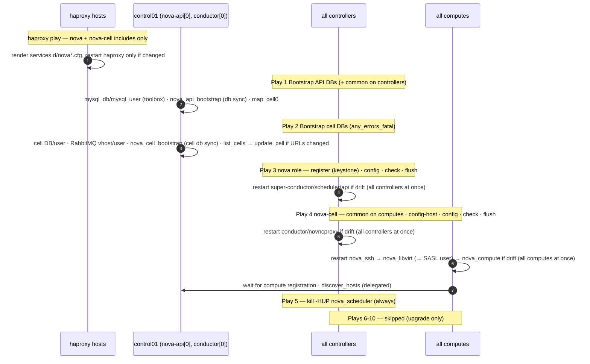
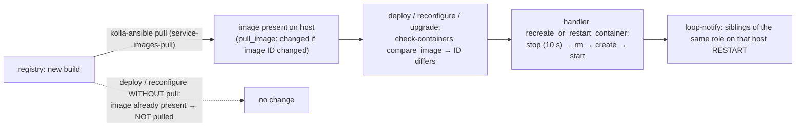

# 07 — Day-2 Operational Impact

What Kolla-Ansible Ussuri commands do when they run against a live platform, read from the source of the **unmodified
`site.yml`**, its roles and Ansible 2.9.27. Nothing was run against a host.

> **Key answers**
>
> - **`-t nova reconfigure` ([§A](#a-reconfigure-nova)):** every compute runs the tasks. Restarts happen only where
>   drift is detected, in practice on no compute or on all of them, and `nova_libvirt` and `nova_ssh` restart whenever
>   `nova_compute` does ([§A.3](#a3-are-all-compute-nodes-affected-does-nova-compute-restart-on-every-compute)). Whether
>   running VMs survive is [NOT AVAILABLE] ([§A.4](#a4-running-vms-live-migration-scheduling)).
> - **`-t neutron reconfigure` ([§B](#b-reconfigure-neutron))** targets every compute. An `ml2_conf.ini` override meant
>   for the server also restarts `neutron_openvswitch_agent` on all computes and network nodes [CODE]
>   ([§B.2](#b2-what-restarts-code)). What an agent restart does to existing connectivity is [NOT AVAILABLE]
>   ([§B.3](#b3-impact-on-networking)).
> - **`-t common reconfigure` reconfigures no host** [CODE] ([§C.1](#c1-the-tag-does-nothing)). `common` reaches a host
>   in the first matching play of a run; `-t chrony` is the recommended way to push its changes
>   ([§C.2](#c2-how-common-actually-reaches-hosts)).
> - **Images ([§D](#d-update-container-images)):** a `deploy` without `pull` does not download a rebuilt image, and a
>   new `openstack_tag` applied with `deploy` recreates every container on every host [CODE]
>   ([§D.1](#d1-how-image-pulling-and-recreation-work-code)). Risks of doing so: [§D.3](#d3-risks).
> - **A service tag also touches** the HAProxy frontends of the service, `common` on every host of the service play,
>   Keystone registration, DB creation and schema sync, and hosts outside `--limit`
>   ([§E](#e-execute-a-service-specific-tag-implicit-effects)). A controller membership change is a fleet-wide restart
>   event for every messaging consumer ([§F](#f-change-control-plane-membership-add-or-remove-a-controller)); what
>   adding a compute with `deploy --limit` touches: [§G](#g-add-a-compute-node).
> - **Recommended pattern:** `genconfig`, then `deploy-containers --limit` batch by batch, with its caveats [CODE]
>   ([§H](#h-separate-write-config-from-apply-recommended-pattern)). Why a small change can create a large workload:
>   [§I](#i-why-a-small-change-can-create-a-large-workload).

**Contents**

- [A. Reconfigure Nova](#a-reconfigure-nova): [A.1 Execution
  sequence](#a1-execution-sequence-kolla-ansible--t-nova-reconfigure) · [A.2 What changes, per type of
  change](#a2-what-changes-per-type-of-change-code) · [A.3 Are all compute nodes affected? Does nova-compute restart on
  every compute?](#a3-are-all-compute-nodes-affected-does-nova-compute-restart-on-every-compute) · [A.4 Running VMs,
  live migration, scheduling](#a4-running-vms-live-migration-scheduling) · [A.5 Operational risks and
  verification](#a5-operational-risks-and-verification)
- [B. Reconfigure Neutron](#b-reconfigure-neutron): [B.1 Execution and targets](#b1-execution-and-targets) · [B.2 What
  restarts](#b2-what-restarts-code) · [B.3 Impact on networking](#b3-impact-on-networking) · [B.4 Risks and
  verification](#b4-risks-and-verification)
- [C. Reconfigure `common`](#c-reconfigure-common): [C.1 The tag does nothing](#c1-the-tag-does-nothing) · [C.2 How
  `common` actually reaches hosts](#c2-how-common-actually-reaches-hosts) · [C.3 Sequence, risks and
  verification](#c3-sequence-risks-and-verification)
- [D. Update container images](#d-update-container-images): [D.1 How image pulling and recreation
  work](#d1-how-image-pulling-and-recreation-work-code) · [D.2 Which nodes download](#d2-which-nodes-download) · [D.3
  Risks](#d3-risks) · [D.4 Verification](#d4-verification)
- [E. Execute a service-specific tag: implicit effects](#e-execute-a-service-specific-tag-implicit-effects): [E.1
  Sequence, impact, risks and verification of `-t <svc>
  reconfigure`](#e1-sequence-impact-risks-and-verification-of--t-svc-reconfigure)
- [F. Change control-plane membership (add or remove a
  controller)](#f-change-control-plane-membership-add-or-remove-a-controller)
- [G. Add a compute node](#g-add-a-compute-node)
- [H. Separate "write config" from "apply" (recommended
  pattern)](#h-separate-write-config-from-apply-recommended-pattern)
- [I. Why a small change can create a large workload](#i-why-a-small-change-can-create-a-large-workload)

**Related:** [03 §3](03-ansible-roles-and-tags-mapping.md#3-what-a-tag-really-executes-master-table) (what each tag
executes) · [08](08-operational-risk-matrix.md) (risks [R1–R25](08-operational-risk-matrix.md#1-matrix) and the
pre-execution checklist) · [09](09-practical-command-reference.md) (the commands) · [05
§5](05-nova-deep-dive.md#5-nova-libvirt-why-its-restart-is-special) (nova-libvirt restarts) ·
[annex/index.md](../annex/index.md) (tag index, everything marked [NOT AVAILABLE])

Drift means what `compare_container` detects: a changed image or container parameter, or `kolla_set_configs --check`
exiting 1 (`library/kolla_docker.py:326-332`; [annex/kolla-images.md
§3](../annex/kolla-images.md#3-kolla_set_configs---check-what-it-compares-and-its-exit-codes)).

Every scenario assumes the same deployed state: 3 controllers, 2 network nodes, 3 computes, 1 storage node and 1
monitoring node, with Keystone, Glance, Placement, Nova, Neutron/OVS, Cinder/LVM, Heat and Horizon.

Throughout this document:

- **The code guarantees** = what Kolla will do (tasks, restarts) given the inputs.
- **Depends on the environment** = what that does to VMs and APIs; mostly [NOT AVAILABLE] in these sources.

The evidence labels **[CODE]** and **[NOT AVAILABLE]** are defined once, in the [README](../README.md#evidence-labels).

Three mechanisms explain almost every surprise below, so they are restated here:

1. **Config drift ⇒ full container stop/start.** It is never a reload. The stop timeout is effectively **10 s** ([01
   §6](01-repository-architecture.md#6-custom-modules--container-lifecycle-via-kolla_docker)).
2. **Loop-notify.** One changed container in a role's loop restarts *every* container of that role on that host ([03
   §2.4](03-ansible-roles-and-tags-mapping.md#24-loop-notify-one-changed-item-notifies-the-handlers-of-all-items-code)).
3. **Global inputs.** `enable_*` flags, group membership and passwords are rendered into per-host files on every host
   ([02 §5](02-openstack-component-dependencies.md#5-compute-node-dependency-summary)).

---

## A. Reconfigure Nova

### A.1 Execution sequence (`kolla-ansible -t nova reconfigure`)



### A.2 What changes, per type of change [CODE]

| Change | Files rewritten | Restarted on controllers | Restarted on **every compute** | Source |
|---|---|---|---|---|
| none | – | none unless a notifying task reports changed | none unless a notifying task reports changed | restart handlers run only when a notifying task reports changed ([03 §2.4](03-ansible-roles-and-tags-mapping.md#24-loop-notify-one-changed-item-notifies-the-handlers-of-all-items-code)); [NOT AVAILABLE] whether every task reports unchanged on an unchanged cloud |
| `/etc/kolla/config/nova.conf` (global override) | `nova.conf` of every nova service | nova_api, nova_scheduler, nova_conductor, nova_novncproxy | **nova_compute, nova_libvirt, nova_ssh** | both `Copying over nova.conf` loops merge `{{ node_custom_config }}/nova.conf` (`roles/nova/tasks/config.yml:51-69`, `roles/nova-cell/tasks/config.yml:63-82`); [03 §2.4](03-ansible-roles-and-tags-mapping.md#24-loop-notify-one-changed-item-notifies-the-handlers-of-all-items-code) |
| `/etc/kolla/config/nova/nova-compute.conf` | `nova-compute/nova.conf` only | – | **nova_compute, nova_libvirt, nova_ssh** (libvirt and ssh by loop-notify) | `roles/nova-cell/tasks/config.yml:63-82`; [03 §2.4](03-ansible-roles-and-tags-mapping.md#24-loop-notify-one-changed-item-notifies-the-handlers-of-all-items-code) |
| `/etc/kolla/config/nova/nova-scheduler.conf` | `nova-scheduler/nova.conf` only | nova_scheduler **+ nova_api** (loop-notify) | – | `roles/nova/tasks/config.yml:51-69`; [03 §2.4](03-ansible-roles-and-tags-mapping.md#24-loop-notify-one-changed-item-notifies-the-handlers-of-all-items-code) |
| `enable_barbican: yes` (Barbican not even deployed) | `nova.conf` everywhere (adds `[barbican]`); `td-agent.conf`, `logrotate.conf` | all nova + fluentd, cron, kolla_toolbox | all nova incl. libvirt + fluentd, cron, kolla_toolbox | `roles/nova/templates/nova.conf.j2:200-205`, `roles/nova-cell/templates/nova.conf.j2:234-239`; `roles/common/defaults/main.yml:105-109`, `roles/common/tasks/config.yml:163-173`; [03 §2.4](03-ansible-roles-and-tags-mapping.md#24-loop-notify-one-changed-item-notifies-the-handlers-of-all-items-code) |
| same as the global `nova.conf` override, with `kolla_serial=1` | same | one controller at a time | **one compute at a time**; API DB sync and map_cell0 repeated per batch (3×) | `nova.yml:39, :111, :132`; [03 §2.5](03-ansible-roles-and-tags-mapping.md#25-run_once-with-serial-code) |

### A.3 Are all compute nodes affected? Does nova-compute restart on every compute?

- **Tasks:** yes. The nova-cell play targets the whole `compute` group (`nova.yml:117-135`). Even when nothing
  changes, every compute makes 46 remote module invocations (53 on compute001), counted from the task files in
  [06 §2](06-compute-scaling-and-performance.md#2-work-per-compute-host-read-from-the-task-files) [CODE]. Its number of
  task results is [NOT AVAILABLE].
- **Restarts:** only where drift is detected. But most Nova-related changes are global ([02
  §5](02-openstack-component-dependencies.md#5-compute-node-dependency-summary), [05
  §2.3](05-nova-deep-dive.md#23-configuration-dependencies-inputs-that-change-novas-files)), so in practice either *no*
  compute restarts or *all* computes restart. They restart in the same handler step unless
  `ANSIBLE_SERIAL`/`kolla_serial` is set or `--limit` is used.
- **libvirt goes with it.** Whenever nova-compute restarts because of config or image drift, **nova-libvirt and
  nova-ssh restart too** (loop-notify, [03
  §2.4](03-ansible-roles-and-tags-mapping.md#24-loop-notify-one-changed-item-notifies-the-handlers-of-all-items-code)).
  Kolla's own handler ordering restarts libvirt *before* nova-compute [CODE]
  (`roles/nova-cell/handlers/main.yml:70-140`; handlers run in definition order, ansible 2.9.27
  `lib/ansible/plugins/strategy/__init__.py:979-985`).

### A.4 Running VMs, live migration, scheduling

| Effect | Guaranteed by code | Depends on environment |
|---|---|---|
| nova-compute stop/start (10 s SIGKILL) | yes, when drift | [NOT AVAILABLE] Whether VMs are unaffected, whether in-flight operations on that host fail or are left mid-task, and whether the service is reported down only if the restart exceeds `service_down_time` ([05 §5](05-nova-deep-dive.md#5-nova-libvirt-why-its-restart-is-special)) |
| libvirtd stop/start | yes, whenever nova-compute drifts | [NOT AVAILABLE] Whether VMs survive. [CODE] The container has `pid_mode: host`, the host `/run` bind mount and `/sys/fs/cgroup` mounted rw (`roles/nova-cell/defaults/main.yml:8, :242, :244`), and the image's start scripts do nothing to QEMU, cgroups or `/var/run/libvirt` (kolla `docker/base/start.sh`, `docker/nova/nova-libvirt/extend_start.sh`; [annex/kolla-images.md §5](../annex/kolla-images.md#5-per-image-start-behaviour)). The open questions are therefore libvirt and Docker behaviour: where libvirtd puts QEMU (for example a host `machine.slice` scope), the stop (`kolla_docker` calls the Docker `stop` with a 10 s timeout, `library/kolla_docker.py:873-884, :892-904`, on a container whose entrypoint is dumb-init, kolla `docker/base/Dockerfile.j2:434`; which signals Docker sends, at the stop and after the timeout, is [NOT AVAILABLE]) and libvirtd re-attaching to running domains when it starts. [NOT AVAILABLE] Whether live migrations in progress fail, and whether libvirt API calls fail until libvirtd is back ([05 §5](05-nova-deep-dive.md#5-nova-libvirt-why-its-restart-is-special)) |
| nova-ssh stop/start | yes, with the above | [NOT AVAILABLE] Whether resize or cold-migration disk copies over port 8022 (`roles/nova-cell/defaults/main.yml:344`) are interrupted |
| Scheduling | API and scheduler restarts are parallel on all controllers (serial 0) | [NOT AVAILABLE] Whether API calls fail during the restart window. [CODE] The scheduler gets SIGHUP on every run that reaches its hosts (cell-cache refresh, `nova.yml:140-156`); [NOT AVAILABLE] whether that is harmless |
| Host mapping | `discover_hosts` runs every time | runs `nova-manage cell_v2 discover_hosts --by-service` to map newly registered computes (`roles/nova-cell/tasks/discover_computes.yml:14-18`); [NOT AVAILABLE] whether it affects existing instances |

### A.5 Operational risks and verification

- **Risks:** [R1](08-operational-risk-matrix.md#1-matrix), [R2](08-operational-risk-matrix.md#1-matrix),
  [R3](08-operational-risk-matrix.md#1-matrix), [R24](08-operational-risk-matrix.md#1-matrix) in
  [08](08-operational-risk-matrix.md).
- **Before:**
  - `kolla-ansible -t nova genconfig` (restarts nothing), then diff `/etc/kolla/nova-*/nova.conf` on one controller
    and one compute.
  - `docker exec -u root nova_compute /usr/local/bin/kolla_set_configs --check; echo $?` on a few computes: exit 1
    means the container *will* restart, and so will `nova_libvirt` and `nova_ssh`.
  - No active live migrations: `openstack server list --all-projects --status MIGRATING`.
- **Apply in batches:** `deploy-containers --limit` ([§H](#h-separate-write-config-from-apply-recommended-pattern)) or
  `ANSIBLE_SERIAL`.
- **After:**
  - `openstack compute service list` (all up);
  - `docker ps --filter name=nova_ -a` (all `Up`, recent `Created`/`Started`);
  - `virsh list --all` inside `nova_libvirt` on a sample of computes (domains running), with guest pings;
  - `nova-manage cell_v2 list_hosts` count equals the number of computes.

---

## B. Reconfigure Neutron

### B.1 Execution and targets

`kolla-ansible -t neutron reconfigure` runs:

1. the haproxy play (neutron-server frontend);
2. the neutron play on `neutron-server`, every agent group, **every compute** and `manila-share` (`site.yml:761-780`).

Per host the steps are: `common` (first play for the host under this tag), register (run_once), config-host
(`ip6_tables` module; sysctl on L3 hosts), config, check-containers, bootstrap, flush. The bootstrap step always runs
the Neutron DB and user/grant tasks (`mysql_db`/`mysql_user` via kolla_toolbox, run_once, delegated to
neutron-server[0], skipped only with `use_preconfigured_databases`, `roles/neutron/tasks/bootstrap.yml:2-34`)
[CODE], so MariaDB must be reachable.
The `bootstrap_neutron` DB-sync container is skipped on reconfigure only because `neutron_enable_rolling_upgrade`
defaults to `yes` (`roles/neutron/defaults/main.yml:411`). With it set to `no`, the DB sync also runs on every
reconfigure (`roles/neutron/tasks/bootstrap_service.yml:21-22`). With `enable_neutron_sfc`, the SFC bootstrap container
runs on every reconfigure regardless (`bootstrap_service.yml:24-46`).

### B.2 What restarts [CODE]

| Change | Restarted | Source |
|---|---|---|
| `/etc/kolla/config/neutron/ml2_conf.ini` (meant for the server) | neutron_server (controllers); **neutron_openvswitch_agent on all computes and network nodes** (`openvswitch_agent.ini` merges `ml2_conf.ini`); on network nodes also **dhcp, l3, metadata agents** (loop-notify) | `roles/neutron/tasks/config.yml:130-150, :172-190`; `roles/neutron/tasks/check-containers.yml:2-18`; [03 §2.4](03-ansible-roles-and-tags-mapping.md#24-loop-notify-one-changed-item-notifies-the-handlers-of-all-items-code) |
| `/etc/kolla/config/neutron.conf` | every neutron container on every host | `roles/neutron/tasks/config.yml:73-106` |
| RabbitMQ/memcached membership change | every neutron container (transport URL) | `group_vars/all.yml:206`; `roles/neutron/templates/neutron.conf.j2:57, :119`; [§F](#f-change-control-plane-membership-add-or-remove-a-controller) |

### B.3 Impact on networking

| Component | On restart (code-guaranteed when drift) | Effect on existing connectivity (environment-dependent) |
|---|---|---|
| neutron-server | API unavailable during the stop/start, on all controllers at once | [NOT AVAILABLE] Whether existing traffic is unaffected, and whether port bindings and new instances fail during the window |
| neutron-openvswitch-agent | container stop/start | [NOT AVAILABLE] Whether flows in OVS persist while the agent is down, whether the agent re-installs flows when it resyncs on start with the Ussuri defaults, and whether a VM loses packets during the agent restart |
| neutron-l3-agent | stop/start; with `enable_neutron_agent_ha: yes` the wrapper **deletes all L3 namespaces** before start (`neutron-l3-agent-wrapper.sh.j2:5-12`) | [CODE] Without the HA cleanup nothing in the wrapper deletes namespaces, and `/run/netns` is shared with the host (`roles/neutron/defaults/main.yml:259`). [NOT AVAILABLE] Whether the namespaces then persist, whether keepalived/haproxy child processes die with the container, whether with the cleanup all routers on that node lose N-S/FIP connectivity until rebuilt, and whether HA routers fail over |
| neutron-dhcp-agent | stop/start | [NOT AVAILABLE] Whether dnsmasq processes die with the container, whether VMs renewing leases in the window fail to renew, and whether new ports wait for the agent to come back |
| neutron-metadata-agent | stop/start | [NOT AVAILABLE] Whether metadata requests (cloud-init) fail during the window |
| Open vSwitch | **not touched** by `-t neutron` (separate play/tag) | – |
| OVN (if `neutron_plugin_agent: ovn`) | `-t neutron` touches neutron-server and `neutron-ovn-metadata-agent`. `-t ovn` re-runs chassis registration on every compute/network node (about 5 `ovs-vsctl` each, always reported changed) and overwrites `ovn-cms-options` ([fact sheet A §5.8](../annex/factsheets/A-infra-lb-ovn.md#58-operationally-notable)) | ovn-controller restart is not triggered by `-t neutron` |

### B.4 Risks and verification

- **Risks:** [R5](08-operational-risk-matrix.md#1-matrix), [R6](08-operational-risk-matrix.md#1-matrix),
  [R7](08-operational-risk-matrix.md#1-matrix).
- **Before:**
  - `openstack network agent list` (all alive);
  - identify the network nodes that host HA router masters;
  - render with `genconfig -t neutron` and diff `openvswitch_agent.ini` on a compute. If it changed, **every compute
    will restart its agent**.
- **Apply:** network nodes one by one (`--limit network01`, then `network02`). Computes in batches.
- **After:**
  - agent list;
  - `ip netns` count on network nodes matches the number of routers/networks;
  - ping a VM's floating IP continuously during each batch.

---

## C. Reconfigure `common`

### C.1 The tag does nothing

`kolla-ansible -t common reconfigure` executes, per play, only the `include_tasks` statement and the `set_fact`. The
included `reconfigure.yml` tasks are filtered out because they do not carry the `common` tag [CODE]
(`roles/common/tasks/main.yml:1-10`; tag semantics in [03
§2.1](03-ansible-roles-and-tags-mapping.md#21-dynamic-include_tasks-and-tag-inheritance-code)). **No host is
reconfigured.**

### C.2 How `common` actually reaches hosts

- **Where it runs:** the `common` role (fluentd, cron, kolla_toolbox) runs on a host during the **first** play of the
  run that includes that host and whose tag matches, then never again in that run (`common_run`).

  | Command | Hosts that get `common` |
  |---|---|
  | `reconfigure` (no tag) | all hosts, in the chrony play (first play; chrony is enabled by default on all physical groups) |
  | `-t nova` | all nova hosts including every compute [CODE] (`nova.yml:117-135`, `roles/nova-cell/meta/main.yml:3`) |
  | `-t neutron` | network + compute + neutron-server hosts |
  | `-t chrony` | all hosts (recommended way to push `common` changes) |
  | `-t haproxy` | haproxy hosts |
- **What it can change:**
  - `td-agent.conf` (fluentd inputs/outputs). It is built from the `enable_*` flags of the services in
    `fluentd_input_openstack_services`, `enable_swift`/`enable_haproxy` (local outputs on swift and haproxy hosts
    only), `glance_enable_tls_backend` (glance-tls-proxy output on every host), the fluentd image's `fluentd_version`
    label (selects the rewrite filter, 0.12 if absent), custom files under `{{ node_custom_config }}/fluentd/` and the
    Elasticsearch/Monasca settings;
  - `logrotate.conf` (cron, built from `cron_logrotate_services`);
  - the RabbitMQ erlang cookie in kolla_toolbox;
  - container definitions of fluentd, cron and kolla_toolbox (image tag, volumes).
- **What restarts:** any drift restarts **all three** containers on that host (loop-notify in
  `check-containers.yml`) [CODE] (`roles/common/tasks/check-containers.yml:2-17`; [03
  §2.4](03-ansible-roles-and-tags-mapping.md#24-loop-notify-one-changed-item-notifies-the-handlers-of-all-items-code)).
- **Impact:**
  - fluentd: log shipping gap. The Elasticsearch and Monasca outputs buffer to files under `/var/lib/fluentd/data`,
    the `fluentd_data` volume, which a restart or a recreate keeps (`roles/common/defaults/main.yml:93`;
    `roles/common/templates/conf/output/01-es.conf.j2:26-27`, `02-monasca.conf.j2:13-14`). The tail read positions
    are in `/var/run/<fluentd_binary>/`, on no volume (`roles/common/templates/conf/input/00-global.conf.j2:14`):
    [NOT AVAILABLE] whether they survive a config-only restart and whether they are lost when the container is
    recreated (e.g. an image or volume change) ([annex/kolla-images.md
    §5](../annex/kolla-images.md#5-per-image-start-behaviour)).
  - cron: log rotation is delayed.
  - kolla_toolbox: no runtime impact on OpenStack. It matters only for Kolla's own tasks.
  - **No VM or API impact.**
- **Hidden coupling:** enabling a service that appears in either list (most OpenStack services, e.g. barbican)
  changes `td-agent.conf` and/or `logrotate.conf` on *every* host ([01
  §5.1](01-repository-architecture.md#51-the-common-role-and-the-common_run-guard)). The common containers therefore
  restart on whatever hosts the *next* run reaches, which can be a seemingly unrelated `-t nova` run
  ([§A.2](#a2-what-changes-per-type-of-change-code)).

### C.3 Sequence, risks and verification

- **Sequence on each reached host** (first matching play only), from `roles/common/tasks/deploy.yml`:
  1. config: config directories; fluentd image label check; `config.json` ×3; custom fluentd files; `td-agent.conf`;
     cron `logrotate.conf`; RabbitMQ Erlang cookie and env files for kolla_toolbox;
  2. check-containers: one looped `compare_container` over fluentd, kolla_toolbox and cron;
  3. bootstrap: `kolla_logs` volume and the `/var/log/kolla` link;
  4. flush handlers, in definition order: Restart fluentd → Restart kolla-toolbox (→ toolbox `ansible --version`
     init) → Restart cron.
- **Hosts, parallelism:** all reached hosts at once, unless batched.
- **Interruption:** one stop/start per container (stop up to 10 s, [01
  §6](01-repository-architecture.md#6-custom-modules--container-lifecycle-via-kolla_docker)). Log shipping pauses, cron
  rotation is delayed, and Kolla's own `kolla_toolbox` tasks wait. **No VM, API, network or storage impact.**
- **Risks:** [R2](08-operational-risk-matrix.md#1-matrix) (fleet-wide restarts after an `enable_*` change),
  [R25](08-operational-risk-matrix.md#1-matrix) (`-t common` mistaken for a reconfigure).
- **Verification:**
  - before: `genconfig`, then `docker exec -u root <c> /usr/local/bin/kolla_set_configs --check; echo $?` in each of
    `fluentd`, `cron` and `kolla_toolbox` (1 in any of them = all three will restart, by loop-notify; a
    `logrotate.conf`-only change, e.g. toggling `enable_chrony` or `enable_mariadb`, shows up only in `cron`). The
    check does not cover image or volume changes;
  - after: `docker ps --filter name=fluentd --filter name=cron --filter name=kolla_toolbox` shows fresh start times;
    `docker logs fluentd` has no parse errors; logs still reach the configured output.

---

## D. Update container images

### D.1 How image pulling and recreation work [CODE]



| Case | Who downloads | What restarts | Source |
|---|---|---|---|
| Same tag, rebuilt image, `deploy` without `pull` | nobody (image already present) | nothing | the local tag still resolves to the image the container runs (`library/kolla_docker.py:299-307, :403-418`) |
| `-t nova pull` | every host in the nova plays, for nova images **and the 3 common images** | nothing | `roles/common/tasks/pull.yml:1-13`, `roles/nova/tasks/pull.yml:1-3`, `roles/nova-cell/tasks/pull.yml:1-3`; `roles/service-images-pull/tasks/main.yml:2-16` (no `notify`) |
| `-t nova deploy` after that pull (only the nova-compute image rebuilt) | – | nova_compute **recreated**, nova_libvirt + nova_ssh **restarted** on every compute | recreate if the container differs, else restart (`library/kolla_docker.py:781-803`); [03 §2.4](03-ansible-roles-and-tags-mapping.md#24-loop-notify-one-changed-item-notifies-the-handlers-of-all-items-code) |
| New `openstack_tag`, `pull` | every host: 11 images per compute, 24 per controller, 12 per network node for this service set, counted as the enabled services mapped to each host | nothing | `roles/service-images-pull/tasks/main.yml:14`, `kolla_ansible/filters.py:82-91`; the hosts are mapped by the groups in `inventory/multinode` and the `<role>_services` defaults (e.g. `roles/mariadb/defaults/main.yml:36-39, :118` for `mariadb_clustercheck`); [06 §2](06-compute-scaling-and-performance.md#2-work-per-compute-host-read-from-the-task-files) (per compute) |
| New `openstack_tag`, `deploy` | – | **every container on every host recreated**: fluentd, cron, toolbox, chrony, iscsid, all nova, OVS db + vswitchd, neutron agents, haproxy, keepalived, MariaDB (rolling), RabbitMQ… | every `<svc>_tag` defaults to `openstack_tag` (e.g. `roles/nova/defaults/main.yml:78`); `library/kolla_docker.py:403-418`; `roles/mariadb/handlers/main.yml:66-78`, `roles/rabbitmq/handlers/main.yml:6-26` |

### D.2 Which nodes download

Every host that runs at least one container whose image reference changed:

- **computes:** nova-compute, nova-libvirt, nova-ssh, OVS db/vswitchd, the neutron OVS agent, plus common, chrony and
  iscsid;
- **network nodes:** agents, OVS, haproxy, keepalived;
- **controllers:** everything else.

`pull` itself never restarts anything. It is safe to run in advance; the Ussuri docs recommend `pull` before
`upgrade`.

### D.3 Risks

- **Changing the tag and running `deploy`** (instead of `upgrade`) recreates the whole fleet in one go, without the
  upgrade-specific ordering (one-shot containers per image: [annex/kolla-images.md
  §4](../annex/kolla-images.md#4-one-shot-containers-what-the-environment-variables-run)):
  - no `nova-status upgrade check`;
  - no RPC-pin reload plays;
  - no online data migrations, except Placement's: its bootstrap container (`KOLLA_BOOTSTRAP`,
    `roles/placement/tasks/bootstrap_service.yml:10-11`) runs `placement-manage db online_data_migrations` on every
    deploy (kolla `docker/placement/placement-api/extend_start.sh:5-9`). Ironic's does the same only with
    `ironic_enable_rolling_upgrade: no` (default `yes`, `roles/ironic/defaults/main.yml:206`;
    `roles/ironic/tasks/bootstrap_service.yml:16`, kolla `docker/ironic/ironic-api/extend_start.sh:5-9`);
  - RabbitMQ is not stopped cluster-wide, but restarted node by node (`roles/rabbitmq/handlers/main.yml:6-26`);
  - Neutron (default `neutron_enable_rolling_upgrade: yes`): instead of expand → restart → contract
    (`roles/neutron/tasks/rolling_upgrade.yml:13-93`), `bootstrap_neutron` runs `neutron-db-manage … upgrade head` for
    neutron, neutron-dynamic-routing, neutron-fwaas and neutron-vpnaas with the new image **before** the handlers
    restart the old `neutron_server` containers (kolla `docker/neutron/neutron-server/extend_start.sh:5-12`;
    `roles/neutron/tasks/deploy.yml:18-21`, `bootstrap_service.yml:2-22`) [CODE]. [NOT AVAILABLE] Whether
    `upgrade head` then applies contract migrations under live old-version servers, and what that does to them.
- **An OVS image change** recreates `openvswitch_vswitchd` on every OVS host simultaneously (serial 0). [NOT AVAILABLE]
  Whether VM networking is interrupted on every compute at the same time. Upgrade OVS per batch:

  ```bash
  ANSIBLE_SERIAL=<n> kolla-ansible -t openvswitch upgrade
  ```

  or use `--limit` batches.
- **Upgrade without a prior pull:** hosts download lazily inside the handler phase (`recreate_or_restart_container`
  pulls *before* stopping, `kolla_docker.py:793-799`), which lengthens and staggers the restart window.

### D.4 Verification

- Before:
  - `docker images | grep <tag>` on a sample of hosts after `pull`;
  - the image IDs match the registry.
- After:
  - `docker ps --format '{{.Names}} {{.Image}}'` shows the new tag everywhere;
  - `docker inspect -f '{{.Image}}' nova_compute` equals the pulled image ID.

---

## E. Execute a service-specific tag: implicit effects

Even with a narrow tag, the code guarantees that the run also touches:

| Implicit effect | Mechanism | Evidence |
|---|---|---|
| **HAProxy frontends of the service, on all haproxy hosts**, and a HAProxy restart if the rendered frontend changed | haproxy play includes `<svc>/loadbalancer.yml` under the same tag; `haproxy-config` is `tags: always`; handlers ignore tags | `site.yml:126-392`; [fact sheet A §1.9](../annex/factsheets/A-infra-lb-ovn.md#19-what-exactly-happens-in-the-haproxy-play-for--t-service-and--t-haproxy); [03 §2.2–2.3](03-ansible-roles-and-tags-mapping.md#22-handlers-ignore-tags-code) |
| **`common` on every host of the service play** (fluentd/cron/toolbox config + container check, restarts if drift) | meta dependency inherits the tag; first-play rule | `roles/nova/meta/main.yml:3`, `roles/common/tasks/main.yml:1-10`; [03 §2.1](03-ansible-roles-and-tags-mapping.md#21-dynamic-include_tasks-and-tag-inheritance-code) |
| **Keystone registration** (service, endpoints, user, role) | `register.yml` in `deploy.yml`/`reconfigure.yml` | `service-ks-register` |
| **DB creation/grants and DB schema sync** for most services (Neutron's DB sync: `deploy` only by default, [§B.1](#b1-execution-and-targets)) | `bootstrap.yml` imported by `deploy.yml` | [CODE] 11 one-shot container runs on a no-change redeploy of this service set (cell0 mapped; MariaDB, RabbitMQ and Fernet keys already bootstrapped): 8 DB-sync bootstraps (keystone, glance, placement, nova API, nova cell, neutron, cinder, heat) + map_cell0 + 2× list_cells, counted from each role's `bootstrap_service.yml` (nova: [03 §3](03-ansible-roles-and-tags-mapping.md#3-what-a-tag-really-executes-master-table)) |
| **RabbitMQ user/vhost** (nova-cell only) | `service-rabbitmq` | `nova-cell/tasks/rabbitmq.yml` |
| **Global MariaDB variable toggle** (`-t glance`) | `log_bin_trust_function_creators` 1→0 | [fact sheet C §1](../annex/factsheets/C-glance-placement-cinder-horizon-heat.md#1-glance) |
| **Fernet key redistribution** (`-t keystone`) | `distribute_fernet.yml` | [fact sheet B §3.6](../annex/factsheets/B-mariadb-rabbitmq-keystone.md#36-fernet-key-lifecycle-fact-unless-marked) (re-run on reconfigure: [§3.7](../annex/factsheets/B-mariadb-rabbitmq-keystone.md#37-bootstrap-db-and-registration-what-re-runs-on-reconfigure)) |
| **Actions on hosts outside `--limit`** | `delegate_to` to `groups[...][0]`: Neutron DB bootstrap on neutron-server[0], cell list/discovery on conductor[0], RabbitMQ user creation on rabbitmq[0] | `roles/neutron/tasks/bootstrap.yml:12-13`, `bootstrap_service.yml:19-20`; `roles/nova-cell/tasks/discover_computes.yml:21`, `wait_discover_computes.yml:42`; `roles/nova-cell/tasks/rabbitmq.yml:12, :22`; [§G](#g-add-a-compute-node) |
| **SIGHUP to every nova-scheduler** (`-t nova`/`nova-api`) | refresh play | `nova.yml:140-156` |

What a service tag does **not** do: it never touches MariaDB, RabbitMQ or memcached *containers* (other plays), and it
never touches OVS (unless `-t openvswitch`). Under `-t haproxy` or a no-tag run, HAProxy and keepalived *containers*
are also checked; a service tag touches only its frontend file.

[CODE] `-t haproxy reconfigure` on an unchanged cloud: `common` + haproxy role on the 2 haproxy hosts
(`site.yml:126-136`, `inventory/multinode:91-92`). All 49 frontend `include_role` tasks are evaluated; 12 run
(placement's, which has no `when`, and the 11 whose `enable_<svc>` is true for this service set) and the other 37 are
skipped by `when: enable_<svc>` (`site.yml:138-389`). Restarts follow only a task that reports changed ([03
§2.4](03-ansible-roles-and-tags-mapping.md#24-loop-notify-one-changed-item-notifies-the-handlers-of-all-items-code));
[NOT AVAILABLE] whether any task does on an unchanged cloud.

### E.1 Sequence, impact, risks and verification of `-t <svc> reconfigure`

For an API service such as keystone, glance, cinder, heat or placement:

1. The gather-facts and group_by plays run on all hosts (`tags: always`).
2. haproxy play, on the haproxy hosts: only the `<svc>` include runs and renders `services.d/<svc>*.cfg`. `common` (a
   meta dependency of the haproxy role) and the haproxy role's own tasks do not carry the `<svc>` tag, so they are
   skipped [CODE] ([03
   §2.3](03-ansible-roles-and-tags-mapping.md#23-include_role--tags-always-inside-the-haproxy-play-code)). HAProxy
   restarts on all haproxy hosts at once if that file changed ([R8](08-operational-risk-matrix.md#1-matrix)).
3. Service play, on the service hosts: `common` → Keystone registration (`run_once`) → config → check-containers →
   DB/user creation and the DB-sync container on the first host → flush. Every drifted host restarts all of the
   service's containers (loop-notify), all such hosts in parallel. Keystone is the exception: it registers last
   ([09 §2.1](09-practical-command-reference.md#21-reconfigure-a-single-service)).

- **Interruption:** the service API is unavailable while its containers restart (up to 10 s stop, then start) on all
  its hosts at once. Add the HAProxy restart window if the frontend changed.
- **VM impact:** none for these services. In-flight glance or cinder transfers are SIGKILLed after 10 s
  ([R24](08-operational-risk-matrix.md#1-matrix)). The tags that [03
  §3.1](03-ansible-roles-and-tags-mapping.md#31-per-tag-answers-files-vms-apis-networkingstorage-safety-prerequisites)
  marks as affecting running VMs are `nova`, `nova-cell`, `neutron`, `openvswitch` and `baremetal` (run by
  `bootstrap-servers`, not `reconfigure`; Docker restart, [R14](08-operational-risk-matrix.md#1-matrix)); for `ovn` and
  `iscsi` it is [NOT AVAILABLE]. Running on computes is not the test: `chrony` runs on every compute and has no VM
  impact.
- **Risks:** [R8](08-operational-risk-matrix.md#1-matrix) (HAProxy restart),
  [R19](08-operational-risk-matrix.md#1-matrix) (Keystone), [R20](08-operational-risk-matrix.md#1-matrix) (glance file
  backend), [R23](08-operational-risk-matrix.md#1-matrix) (`--limit` on a large inventory),
  [R24](08-operational-risk-matrix.md#1-matrix) (10 s SIGKILL).
- **Verification:**
  - before: `kolla-ansible -t <svc> genconfig`, then
    `docker exec -u root <c> /usr/local/bin/kolla_set_configs --check; echo $?` in each `<svc>` container (without
    `-u root` it exits 2 in images that run as a service user, e.g. glance-api;
    [annex/kolla-images.md §3.4](../annex/kolla-images.md#34-running-it-by-hand-needs-root)) and a diff of
    `/etc/kolla/haproxy/services.d/<svc>*.cfg` against the previous version;
  - after: `openstack endpoint list --service <name>` is unchanged for each Keystone service the role registers (each
    `name` in `<svc>_ks_services`, e.g. `cinderv2` and `cinderv3` for cinder, `heat` and `heat-cfn` for heat), the API
    answers through the VIP, the container start times show which hosts restarted, and
    `docker ps --filter name=haproxy` shows whether HAProxy restarted.

---

## F. Change control-plane membership (add or remove a controller)

[CODE] Adding `control04` to `control` (and therefore to `rabbitmq`, `memcached`, `mariadb`, …) and running
`-t nova,neutron reconfigure`, read from the templates:

- **Restarted on every compute:** nova_compute, nova_libvirt, nova_ssh, neutron_openvswitch_agent.
- **Restarted on every controller:** all nova and neutron containers.
- **Restarted on both network nodes:** all neutron agents; haproxy (backend lists changed).
- **Why:** `rpc_transport_url` lists every RabbitMQ host (`group_vars/all.yml:206`,
  `roles/nova-cell/defaults/main.yml:174`), and the haproxy backends list every API host
  (`roles/haproxy-config/templates/haproxy_single_service_split.cfg.j2:93`). Loop-notify ([03
  §2.4](03-ansible-roles-and-tags-mapping.md#24-loop-notify-one-changed-item-notifies-the-handlers-of-all-items-code))
  restarts the sibling containers.
- **Plus:** RabbitMQ and Galera cluster joins, which need their own plays (`-t rabbitmq`, `-t mariadb`).
  Galera membership changes restart all DB nodes (`galera.cnf` lists all nodes, [fact sheet B
  §1.4](../annex/factsheets/B-mariadb-rabbitmq-keystone.md#14-config-files-generated-ansiblerolesmariadbtasksconfigyml)
  and [§1.8](../annex/factsheets/B-mariadb-rabbitmq-keystone.md#18-operationally-notable-behaviour-risks-and-oddities)
  item 11).

**Takeaway:** controller membership changes are fleet-wide restart events for every messaging consumer. Schedule them
as such, and batch the compute side.

---

## G. Add a compute node

[CODE] `deploy --limit compute004` (after `bootstrap-servers --limit` and `pull --limit`), read from the plays and
task files:

- **On compute004:** 11 containers created, one per `compare_container` item of a compute ([06
  §2](06-compute-scaling-and-performance.md#2-work-per-compute-host-read-from-the-task-files)). The number of task
  results is [NOT AVAILABLE].
- **Elsewhere (via `delegate_to`):**
  - a Neutron bootstrap (DB sync) container on `control01` (`roles/neutron/tasks/bootstrap_service.yml:19-22`);
  - `nova-manage cell_v2 list_cells` and `discover_hosts` on `control01`
    (`roles/nova-cell/tasks/discover_computes.yml:4-21`, `get_cell_settings.yml:2-20`);
  - a Keystone API call to wait for compute registration (`roles/nova-cell/tasks/wait_discover_computes.yml:8-42`).
- **Facts:** gathered for all 12 hosts. The new compute itself runs the delegated `setup` loop sequentially
  (`gather-facts.yml:29-50`).
- **Not touched:** existing computes, apart from the delegated `setup` above. Controllers get no config writes or
  restarts, only delegated tasks: those listed above, the fact gathering above (`setup` on all three controllers), and
  the Neutron DB and DB-user tasks (`mysql_db`, `mysql_user` run through `kolla_toolbox`) on `control01`.
- **Caveats:**
  - Existing hosts' `/etc/hosts` is not updated (`bootstrap-servers --limit`).
  - With `libvirt_tls: true` (hostname-based migration), the other computes cannot resolve the new host until a
    full `bootstrap-servers` run, which carries its own Docker-restart risk
    ([R14](08-operational-risk-matrix.md#1-matrix)).

---

## H. Separate "write config" from "apply" (recommended pattern)

[CODE]

1. `kolla-ansible -t nova genconfig` writes the new `nova.conf` on all hosts. **Zero restarts**: every container restart
   handler has `when: kolla_action != "config"` (e.g. `roles/nova-cell/handlers/main.yml:84-85, :107-108, :139-140`).
   The only unguarded restart handlers are the deprecated nova-hyperv Windows-service ones, which `-t nova` does not
   select ([08 §3](08-operational-risk-matrix.md#3-pre-execution-checklist-applies-to-every-production-run)).
2. `kolla-ansible -t nova deploy-containers --limit compute001` restarts only compute001's nova containers. Drift is
   detected by `kolla_set_configs --check` inside `compare_container`. On compute001 its tasks make 7 remote module
   invocations (`setup` and 6 `compare_container`) plus the delegated fact loop ([06
   §2](06-compute-scaling-and-performance.md#2-work-per-compute-host-read-from-the-task-files)), with no bootstrap, no
   Keystone registration and no haproxy play (`roles/nova-cell/tasks/deploy-containers.yml:2`, `nova.yml:49-51`,
   `site.yml:390-392`).
3. Repeat per batch. Controllers (API, scheduler, conductor) are applied with their own `--limit` batch.

Caveats:

- Between steps 1 and 3, **any other Kolla run that reaches those hosts applies the pending drift in files listed in
  `config_files`**. That includes an unrelated `-t chrony` run that touches common: the nova containers are not
  checked by it, but the common ones are.
- Drift confined to `config.json`'s `command` or `permissions` (e.g. memcached's `-m`/`-c`, whose `config_files` is
  empty) is never detected: `kolla_set_configs --check` compares only `config_files` (kolla
  `docker/base/set_configs.py:407-410`, [annex/kolla-images.md
  §3](../annex/kolla-images.md#3-kolla_set_configs---check-what-it-compares-and-its-exit-codes)), and the template task
  is already unchanged. No later Kolla run restarts the container for it, step 2 included. It takes effect only at the
  next restart for another reason.
- Hosts restarted by Docker or reboot also pick up the new config, because `COPY_ALWAYS` copies the files and rewrites
  `/run_command` at container start (kolla `docker/base/set_configs.py:319-324,391-393`). Keep the window short.

---

## I. Why a small change can create a large workload

| Small change | Why it is large | Source |
|---|---|---|
| One option for nova-compute | targets every compute; loop-notify adds libvirt + ssh restarts | `nova.yml:117-135`; [03 §2.4](03-ansible-roles-and-tags-mapping.md#24-loop-notify-one-changed-item-notifies-the-handlers-of-all-items-code); [§A.2](#a2-what-changes-per-type-of-change-code) |
| `enable_<new service>: yes` | changes fluentd/logrotate on every host and `nova.conf` sections on every compute | `roles/common/defaults/main.yml:105-109`, `roles/common/tasks/config.yml:163-173`; [§A.2](#a2-what-changes-per-type-of-change-code) |
| One extra controller | changes the transport URL in every messaging service everywhere | `group_vars/all.yml:206`; [§F](#f-change-control-plane-membership-add-or-remove-a-controller) |
| A server-side ML2 option | also merged into every OVS agent config | `roles/neutron/tasks/config.yml:172-190`; [§B.2](#b2-what-restarts-code) |
| Rebuilt image of one service | its siblings on the same host restart too | `library/kolla_docker.py:403-418`; [03 §2.4](03-ansible-roles-and-tags-mapping.md#24-loop-notify-one-changed-item-notifies-the-handlers-of-all-items-code); [§D.1](#d1-how-image-pulling-and-recreation-work-code) |
| Any OpenStack API service `-t <svc>` | runs common, the service's haproxy include and Keystone registration even with no change; the DB sync runs on every `deploy` and, for most services, on every reconfigure (Neutron: `deploy` only by default). Infrastructure tags such as `-t haproxy` run no Keystone registration or DB sync | [§B.1](#b1-execution-and-targets), [§E](#e-execute-a-service-specific-tag-implicit-effects); `site.yml:126-392` |

And independently of restarts, **every run pays the per-host work** [CODE]. Per compute, a no-change `-t nova` run
makes 46 remote module invocations (53 on compute001), and every full `deploy` or `reconfigure` makes 11
`compare_container` calls, counted from the task files in [06
§2](06-compute-scaling-and-performance.md#2-work-per-compute-host-read-from-the-task-files). The number of task results
per compute is [NOT AVAILABLE].
