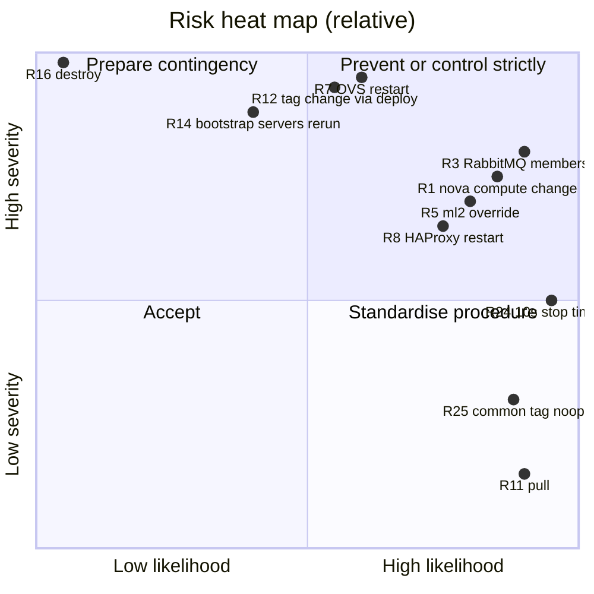

# 08 — Operational Risk Matrix

Potentially dangerous operations on a running Kolla-Ansible Ussuri platform: their impact and the precautions to take
before running them. Ratings are relative to a production cloud with running VMs.

- **Likelihood** = how likely the operation is to cause the impact *when the triggering condition is present*.
- **Severity** = worst realistic outcome.
- **Evidence** links to the source or lab finding; [HYPOTHESIS] or [NEEDS-LAB] mark items that require validation.

Scenario walk-throughs are in [07](07-day2-operational-impact.md); the commands are in
[09](09-practical-command-reference.md).

---

## 1. Matrix

| # | Operation / trigger | What actually happens | Blast radius | VM impact | API impact | Likelihood | Severity | Precautions | Evidence |
|---|---|---|---|---|---|---|---|---|---|
| R1 | Any config change touching **nova-compute** (override, global flag, password, RabbitMQ list) followed by `deploy`/`reconfigure` with a nova tag or no tag | `nova_compute` **and `nova_libvirt` and `nova_ssh`** restart on every affected compute, **all at once** (serial 0). The cause is the loop-notify behaviour | all computes | libvirtd restart: live migrations in flight fail; VMs normally keep running [NEEDS-LAB] | nova-compute down for ~10–30 s per host | High | High | `genconfig` + `diff`, then `deploy-containers --limit` in batches, or `ANSIBLE_SERIAL`; drain live migrations first; validate libvirt restart behaviour in staging | [LAB s02/s03/s07]; 03 §2.4; 05 §5 |
| R2 | Enabling or disabling a service that has a logrotate or fluentd input entry (`enable_X` for most OpenStack services, e.g. barbican) in `globals.yml`, then running any play that includes `common` | `td-agent.conf` and `logrotate.conf` render differently on **every host** → `fluentd`, `cron` **and `kolla_toolbox`** restart (loop-notify) on every host where a play that runs `common` executes: the whole fleet for an untagged run, only the tagged service's hosts for a tagged run (s07, `-t nova`: 6 of 10 hosts; the others keep the old files until a later run includes `common` there). Nova/Cinder/Glance configs gain sections (e.g. `[barbican]`) → those services restart too. Flags in neither list (e.g. `enable_prometheus`, `enable_ovn`, `enable_openvswitch`, `enable_memcached`, `enable_placement`, `enable_redis`) leave both files unchanged | fleet-wide (untagged run); the service's hosts (tagged run) | none from fluentd; Nova restarts as R1 | short | High | Medium–High | Treat `enable_*` changes as fleet-wide changes. Roll out with `--limit` batches | [LAB s07]; `roles/common/tasks/config.yml:109-240`, `roles/common/defaults/main.yml:105-187` |
| R3 | Changing RabbitMQ group membership (adding/removing a controller), RabbitMQ password or port | `rpc_transport_url` changes in **every** messaging service on every host → all nova, neutron (and any compute-side agent) containers restart; `update_cell` rewrites the cell's MQ URL | all hosts | as R1 plus neutron agent restart (flow resync) | yes | Certain | High | Plan as a maintenance; batch with `--limit`; verify RabbitMQ cluster health first | [LAB s12]; `group_vars/all.yml:206,216` |
| R4 | Changing memcached membership | 38 roles embed the memcached host list in their configs (37 template loops plus monasca's `monasca_memcached_servers`; fact sheet B §3.10 counts 36, corrected in annex/factsheets/README.md), so their services restart when their plays run; token caches flushed. Not only the control plane: `neutron.conf` is shared by every neutron agent, so `neutron_openvswitch_agent` restarts on every compute and network node, and the dhcp, l3 and metadata agents, which get the same file, restart on network nodes; `cinder.conf` reaches cinder-volume/backup and `ceilometer.conf` ceilometer-compute. Compute `nova.conf` has no memcached list | controllers + network nodes + all computes (+ storage) | as R5: OVS agent flow resync; router/DHCP interruption on network nodes [NEEDS-LAB]; with `enable_neutron_agent_ha`, the R6 netns cleanup | brief auth latency, Horizon logouts | Certain | High | Plan as a dataplane change, like R3/R5: batch with `--limit` or `ANSIBLE_SERIAL`, network nodes one at a time; low-traffic window | fact sheet B §3.9 item 2, §3.10; `roles/neutron/templates/neutron.conf.j2:119`, `roles/neutron/tasks/config.yml:73-98`; [LAB s12: compute001's OVS-agent `neutron.conf` lists all 4 memcached hosts] |
| R5 | `/etc/kolla/config/neutron/ml2_conf.ini` override (meant for neutron-server) | also merged into `openvswitch_agent.ini` → **every OVS agent** restarts (computes + network). On network nodes, loop-notify also restarts dhcp, l3 and metadata agents | network + all computes | flow resync; on network nodes router/DHCP interruption [NEEDS-LAB] | neutron-server restart | Certain | High | Put server-only options in `neutron/neutron-server.conf`, or check the rendered `openvswitch_agent.ini` diff | [LAB s05]; `roles/neutron/tasks/config.yml:172-190` |
| R6 | Any restart of `neutron_l3_agent` with `enable_neutron_agent_ha: yes` | the wrapper runs `neutron-netns-cleanup --force --agent-type l3` **before** the agent starts → all router namespaces on that node are deleted, then rebuilt | network nodes (and DVR computes) | north-south and floating-IP traffic interrupted for routers on that node until rebuilt; HA routers fail over [HYPOTHESIS] | none | Certain (if HA flag) | High | Restart network nodes one at a time; fail routers over first | `roles/neutron/templates/neutron-l3-agent-wrapper.sh.j2:5-12` |
| R7 | `openvswitch_vswitchd` restart or recreate (image change, `start-ovs` change, `-t openvswitch` with a changed image) | OVS datapath restarts; flows are reprogrammed by the agent | per host (all OVS hosts at once with serial 0) | **all VM network traffic on the host interrupted** until flows are restored [HYPOTHESIS: seconds to minutes] | none | Certain on image change | Critical | Upgrade or recreate OVS host by host with evacuation or acceptance; never fleet-wide with serial 0 | `roles/openvswitch/handlers/main.yml:28-42` |
| R8 | HAProxy config change (any service frontend, certs, `haproxy.cfg`) | `haproxy` **restarted** (never reloaded) on all haproxy hosts at once; keepalived may drop or move the VIP for ~20 s | all APIs + **all DB traffic** (DB address is the VIP) | none directly; nova/neutron DB errors during the gap | yes | Certain if changed | High | `ANSIBLE_SERIAL=1` for haproxy changes; `--skip-tags haproxy` when you don't intend to change frontends | fact sheet A §1.8 |
| R9 | MariaDB config change or image change | rolling restart in 4 waves by `index % 4`; HAProxy's single active backend (node 0) restarts first; each wave waits ~60 s for WSREP Synced, and the next wave may continue after a failure [HYPOTHESIS] | DB cluster | none directly | DB connection resets | Certain if changed | High | Check `wsrep_cluster_size` and `Synced` on all nodes before; take a backup (`mariadb_backup`); watch between waves | fact sheet B §1.2, §1.5, §1.8 items 1 and 3 |
| R10 | RabbitMQ image change (`upgrade`) | **all brokers stopped**, full message-bus outage during upgrade; config change → one-by-one restart | all RPC | nova-compute heartbeats are lost, so services are reported down | yes | Certain on upgrade | High | Maintenance window; expect agent and compute "down" alarms | fact sheet B §2.8 items 1–2 |
| R11 | `kolla-ansible pull` | downloads images on every host (11 per compute in the lab profile) | registry + network | none | none | – | Low (bandwidth) | Run ahead of maintenance; rate-limit with `--forks`; local registry mirror | [LAB s10] |
| R12 | Changing `openstack_tag` / `*_tag` and running `deploy` instead of `upgrade` | every container is **recreated** (fleet-wide); upgrade-specific steps (RPC pin removal, online migrations, nova-status check) do **not** run | fleet-wide | as R1 + R7 + R8 together | yes | Certain | Critical | Use `pull` then `upgrade` (Ussuri docs); per-service tags; `ANSIBLE_SERIAL` | [LAB s11]; `doc/source/user/operating-kolla.rst:119-142` |
| R13 | Rebuilt image pushed under the **same tag**, then `deploy`/`reconfigure` without `pull` | nothing changes (only absent images are pulled). After `pull`: recreate, plus loop-notify restarts | – / role-wide | as R1 | – | – | Medium (drift) | Use immutable tags; always `pull` deliberately | [LAB s09a-c]; `kolla_docker.py:805-808` |
| R14 | `bootstrap-servers` re-run on a live host | can **restart the Docker daemon** (if `daemon.json` changes) → every container on the host restarts, on **all hosts at once** by default; also disables firewalld/ufw, sets SELinux permissive, removes host packages (`open-iscsi`, `libvirt*`, `chrony`, …) | per host / fleet | Docker restart = nova_libvirt + OVS restart → see R1/R7 | yes | Medium | Critical | Run only with `--limit` on new hosts, or `-e kolla_serial=1`; diff `daemon.json` first | fact sheet E §1–2 |
| R15 | `kolla-ansible stop` | stops all Kolla containers (incl. nova_libvirt, OVS, MariaDB) on targeted hosts | targeted hosts | VM networking lost; libvirt gone | yes | Certain | Critical | Use `--limit` + tags + `skip_stop_containers`; MariaDB then needs `mariadb_recovery` | `tools/kolla-ansible:441-453`; fact sheet B §1.3 (stop), §1.8 item 4 |
| R16 | `kolla-ansible destroy` | removes containers, volumes, `/etc/kolla/*` (except a few files), **all network namespaces and tap/brq/vxlan links** (`tools/cleanup-host`) | targeted hosts incl. deploy host (`hosts: all`) | total | total | Certain | Critical | Never on production; there is no `--limit` safety net beyond what you pass | fact sheet E §6 |
| R17 | `prune-images` | removes *dangling* Kolla images only | per host | none | none | Low | Low | – | fact sheet E §7 |
| R18 | `mariadb_recovery` | **stops every MariaDB node**, even healthy ones, and bootstraps from the highest seqno | DB cluster | none directly | full DB outage | Certain | High | Only when the cluster is fully down; identify the node with the highest seqno manually first | fact sheet B §1.3 (Recovery step 3), §1.8 item 5 |
| R19 | Keystone `reconfigure` (any keystone change, including memcached/RabbitMQ membership) | all keystone containers restart on all hosts at once; fernet keys re-pushed from the first running node, deleting others' keys; db sync runs | identity | none | auth outage of seconds | Certain if changed | Medium–High | `ANSIBLE_SERIAL`; verify fernet key consistency before and after | fact sheet B §3.5, §3.6, §3.7, §3.9 items 1–2 |
| R20 | Glance reconfigure / deploy | toggles **global** MariaDB `log_bin_trust_function_creators` 1→0 around db sync; with the file backend only `glance-api[0]` exists → any restart is a full Image API outage | DB + glance | snapshots in progress fail [HYPOTHESIS] | Image API outage | Certain | Medium | Avoid during image-heavy operations | fact sheet C §1 |
| R21 | Enabling Swift (or `glance_backend_ceph`) on a running cloud | silently switches Glance's backend; existing file-store images may become unreadable [NEEDS-LAB] | glance | boots from existing images fail | yes | High | High | Set `glance_backend_*` explicitly before enabling Swift | fact sheet C §1.8 |
| R22 | Inventory reordering (haproxy, mariadb, glance, nova-conductor, keystone groups) | keepalived priorities change; MariaDB restart waves and active backend move; glance moves (file backend); bootstrap/discovery target changes | per group | indirect | possible | Medium | High | Treat inventory order as configuration; never reorder casually | fact sheets A §1.8, B §1.2, §1.5, C §1 |
| R23 | Any run **with `--limit`** on a large inventory | fact gathering for **all** hosts is executed **sequentially** by the limited hosts (delegated loop) → long runtime; `/etc/hosts` and other cross-host files are not updated on non-limited hosts | – | none | none | Certain | Low (time), Medium (drift) | Enable fact caching (`ansible-tuning.rst`); follow up with a full run when cross-host config changed | [LAB s13: 11 `setup` calls, 1 local plus 10 delegated and run in sequence by compute001]; `gather-facts.yml:29-50` |
| R24 | Effective container stop timeout is **10 s**, not `docker_graceful_timeout` | services are SIGKILLed after 10 s on every restart (heat-engine, cinder-volume copies, glance uploads, libvirtd) | all restarts | in-flight operations killed | – | Certain | Medium | Drain long operations before restarts; patch `kolla_docker` or pass `graceful_timeout` if needed | [LAB kolla_docker_params]; `kolla_docker.py:991,1037-1047` |
| R25 | `-t common` believed to reconfigure fluentd/cron | **no-op** → config drift remains and is applied unexpectedly later by an unrelated service run | – | – | – | Certain | Low–Medium (surprise) | Use `-t chrony` (all hosts) or a service tag; verify with `docker exec … kolla_set_configs --check` | [LAB s08]; 03 §2.1 |

---

## 2. Heat map (likelihood × severity)

---

## 3. Pre-execution checklist (applies to every production run)

1. **Know the diff before you run.**
   - Run `kolla-ansible genconfig` with the same tags and `--limit`. This writes config but does not restart any
     Docker container: every container restart handler has `when: kolla_action != "config"`, and the handlers
     without that guard are no-ops, steps chained to guarded handlers, or bootstrap, check-containers or upgrade
     steps that genconfig never notifies. Exception: the deprecated nova-hyperv role's handlers
     (`roles/nova-hyperv/handlers/main.yml:2-15`) are unguarded and are notified directly by its `config.yml`, so
     with `enable_hyperv` genconfig can restart the Windows nova-compute, neutron-hyperv-agent and FreeRDP-WebConnect
     services; keep Hyper-V hosts out of the `--limit`.
   - Then diff `/etc/kolla/<service>/` against the previous version. Keep `/etc/kolla` under version control on
     every host, or snapshot it before the run.
   - On each container, `docker exec -u root <c> /usr/local/bin/kolla_set_configs --check` tells you whether it *will* be
     restarted (exit 1 = drift).
2. **Know the restart set.** Remember loop-notify: if one container of a role changes on a host, every container of
   that role on that host restarts (03 §2.4).
3. **Know the batch size.**
   - `ANSIBLE_SERIAL` covers `reconfigure`/`upgrade`; `-e kolla_serial=N` covers `deploy`.
   - mariadb and rabbitmq ignore it.
   - cyborg uses the wrong variable.
4. **Pull first.** `kolla-ansible pull` (with the same tags) before `upgrade`/`deploy`, so that restart windows do not
   include downloads.
5. **Health gates.** Before the run, check:
   - Galera: `wsrep_cluster_size`, `wsrep_local_state_comment=Synced`;
   - RabbitMQ: cluster status, no partitions;
   - `openstack compute service list` and `openstack network agent list` all up;
   - HAProxy backends all UP.

   Repeat after each batch.
6. **Workload gates.** No live migrations, resizes, image uploads or volume migrations in flight on the targeted
   hosts. Check `openstack server list --all-projects --status MIGRATING|RESIZE` and `openstack volume list
   --status *ing`.
7. **Scope.**
   - Prefer `--limit` and the narrowest tag.
   - Add `--skip-tags haproxy` when the frontends are not meant to change.
   - Never use `-t common` expecting it to do something.
8. **Rollback material.**
   - Previous `/etc/kolla/config`, `globals.yml`, `passwords.yml` and inventory under git.
   - Previous image tags still present locally (do not `prune-images` before you are done).
   - A MariaDB backup (`kolla-ansible mariadb_backup`).
